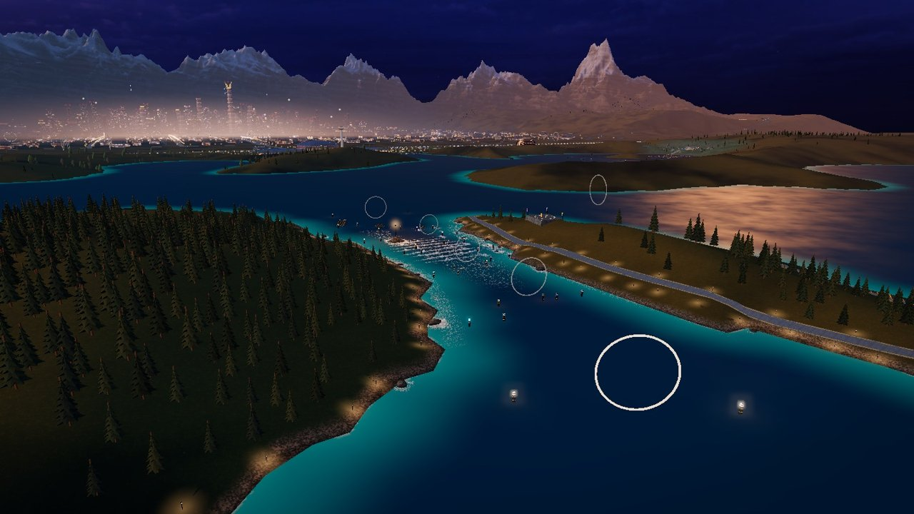
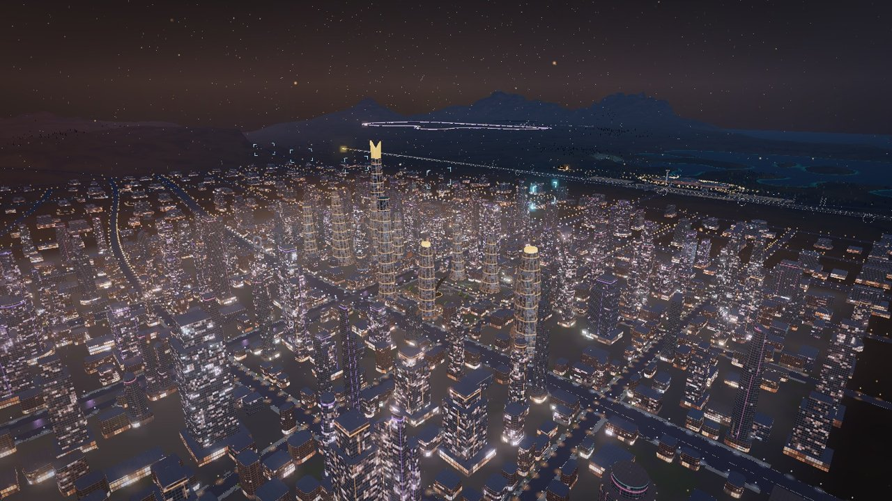
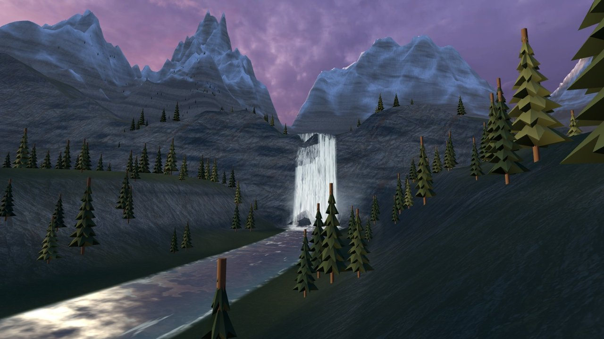
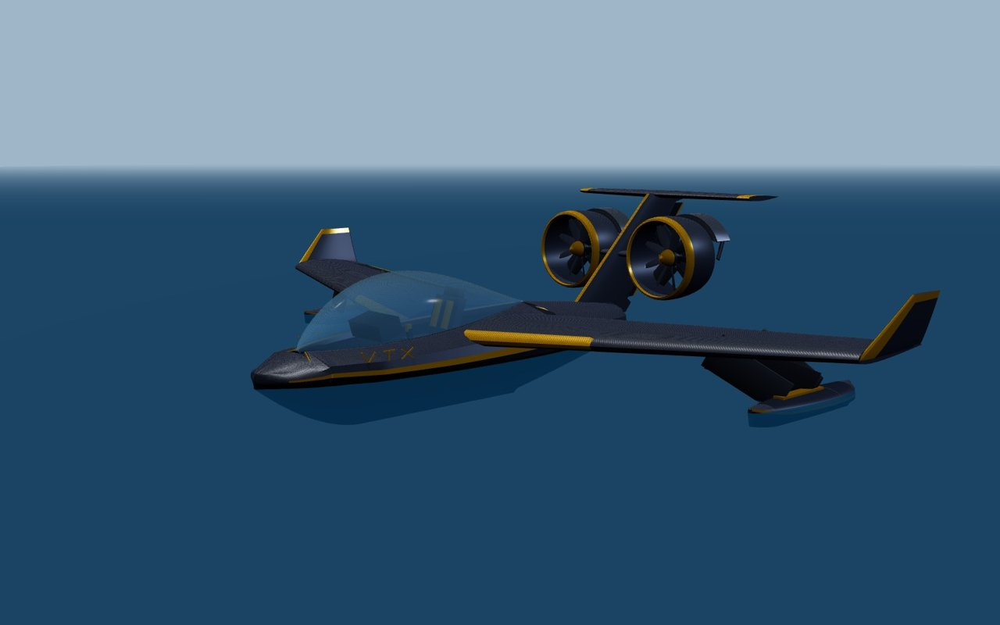

# Vaderland

**Build the machine. Train the pilot. Challenge the physics.**

Vaderland is the evolving world of **VTX · Vader’s Taxis** — a physics-driven playground for experimental aircraft, cars and watercraft. Fly from the airfield to the city, drive from the hills to the marina, or put a machine through a timed trial. Take the controls yourself, or hand them to an AI pilot.

It began with a conversation about a flying car. Selected 2D concept art became the Argon R6 through engineering calculations and simulation. The Phantom and Ricochet followed the same path from concept to physics-driven vehicles.

**AI piloting is part of the experiment, not a scripted demonstration.** AI models have already flown VTX vehicles using limited pilot-facing observations, conversational instructions and live control decisions. Dedicated AI-only time trials are planned.


*Phantom A10-D on the northwest approach to Meridian. Captured in Vaderland 32 using a retained manual flight.*

[Watch the showcase](docs/VADERLAND_MEDIA.md) · [Vaderland 33 notes](docs/VADERLAND_ROOFTOP_QUARTER.md) · [Ricochet technical docs](docs/ricochet/README.md) · [Vaderland 32 field report](docs/VADERLAND_32_VERIFICATION.md) · [Open the browser cockpit](https://vtx-flight-sim.vercel.app/)

The showcase uses recorded physics-based simulation runs, including failed attempts. Camera angles and cuts are editorial; vehicle movement and outcomes come from the source runs.

## Build, pilot, experiment

Vehicle creation is being developed in difficulty tiers: start with known components, customise chassis and controls, or go full engineer with a design of your own. The same physics applies at every tier. If a machine can't generate the lift, thrust or traction it needs, the simulator won't pretend otherwise.

Talk to your AI pilot, learn from its decisions and fly alongside it. The tiered vehicle creator and AI-only competitions are development goals; the vehicles, routes and tests available today are described below.

## Explore the world

| Area | What to try |
| --- | --- |
| **Meridian Airfield and Arrivals** | Depart from Runway 08/26 or practise vertical approaches. The Arrivals apron hosts the Argon transport footage in the showcase. |
| **Meridian City** | Fly the High Line or try the tighter Parallax Thread. Crest Gardens and the illuminated skyline give pilots landmarks to navigate by. |
| **Cathedral of Velocity** | Drive the tunnel and quarry routes or attempt a vertical loop. Two stock Phantom A10-C Grand Loop attempts ended in DNFs. |
| **Lantern Sound** | Follow the Shore Link from Arrivals to Lantern Marina. Take a Ricochet out through the marked channels, race the eight-gate Islet Trial, or return to berth. |
| **Meridian Rooftop Quarter** · *Vaderland 33* | Land on 32 rooftop zones in four size classes, fly eight rooftop missions through hoops, or drive the 14 ward mini-tracks and their ramps. At night the city glows where people live. |
| **The Lantern Race** · *Vaderland 33* | Take a Ricochet through the white water between Heron and Needle Islands: the Main Chute, the Rock Garden slalom or the Eddy Line. The current, standing waves, eddies and rocks are physics the hull feels, and three floating ramps throw boats into the air. |
| **The Brake Line** · *Vaderland 33* | An air course laid along the recorded A10-B air-brake turn of 9 November. |
| **Falls Gorge and the high country** · *Vaderland 33* | Waterfalls fall clear of the cliffs into churning pools. Alpine trails, East Ridge and lit salvage landmarks run through the mountains around the city. |

Ray’s design rule is that the world rewards skill, exploration and experimentation. Each vehicle brings its own capabilities to a route. A sharp transition can defeat a fast car, a narrow pass can demand a smaller aircraft, and the replay keeps the result.

| **Lantern Marina and Shore Link** | **R6 Argon at Main Airport** |
| --- | --- |
|  |  |
| **The Lantern Race (Vaderland 33)** | **Meridian at night (Vaderland 33)** |
|  |  |
| **Falls Gorge (Vaderland 33)** | **Ricochet RC-01 Concept A** |
|  |  |

## Builds and verification

- **Vaderland 33** is the current build, in [PR #70](https://github.com/SDarkVader/-vtx-flight-sim/pull/70). It is the default world, first in the environment list. It adds the Meridian Rooftop Quarter, the Lantern Race, the Brake Line, the Falls Gorge waterfalls and the alpine trails.
  - **Drawing:** the browser draws every display frame on desktop. Aircraft and boats glide between their true physics poses, and night lights bloom with round halos.
  - **Free camera:** it crosses the world in seconds, and its **Go to…** list flies to any of 34 named places.
  - **Harbour performance:** the harbour runs its rigid bodies at 100 Hz, hull hydrodynamics at 20 Hz and shallow water at 10 Hz. Its water solver recomputes only the cells that change, with results bit-identical to the full stencil.
  - **CI:** the full suite passes on Linux CI (626 Python and 103 browser tests). World and runtime identities match on Windows and Linux.
- **Vaderland 32** is the reviewed [environment snapshot](https://github.com/SDarkVader/-vtx-flight-sim/tree/codex/vaderland-v32) used for the earlier field check. The A10-D took off vertically, approached Meridian and eventually struck terrain. The Shore Link drive and Islet Trial also have recorded checks.
- **Main Airport and harbour** remain selectable as the earlier prototype. **Choose vehicle** offers the Phantom A10-C, Argon R6 and Ricochet, and also lists the experimental A10-D and historical variants.

MuJoCo supplies the aircraft and contact dynamics. The browser draws the simulated state and provides cockpit, chase and map views. For the Phantom, the 400 Hz physics clock runs independently of video frame rate and telemetry delivery. Flight Records retains outcomes, including missed approaches, collisions and successful landings. The field report publishes selected findings. The primary flight telemetry, pilot inputs and crash recording stay on the test PC.

## Run VTX locally

For an authorized Windows test, use Python 3.11 and a browser with WebGL 2. Run these commands from the repository root in PowerShell.

```powershell
py -3.11 -m venv .venv
.\.venv\Scripts\python.exe -m pip install -r requirements.txt
.\.venv\Scripts\python.exe scripts\launch_unified.py
```

The launcher opens the cockpit and reports its port and save directory. Pass `--check` to inspect configuration, or `--data-root` to choose a save directory. Use **Save flight & switch** before selecting another aircraft. Supported checkpoints open paused for review before resuming.

To open straight into Vaderland 33, set the default world before launching:

```powershell
$env:VTX_DEFAULT_ENVIRONMENT = "vaderland-33"
.\.venv\Scripts\python.exe scripts\launch_unified.py
```

## Reference

- [Vaderland 33: Rooftop Quarter, Lantern Race, falls and free camera](docs/VADERLAND_ROOFTOP_QUARTER.md)
- [Ricochet RC-01 technical documentation](docs/ricochet/README.md): geometry, mass, controls, propulsion, hydrodynamics and harbour operations
- [Cockpit gallery](docs/COCKPIT_GALLERY.md) and [vehicle controls](docs/VEHICLE_CONTROLS_20261117.md)
- [Main vehicle test checklist](docs/MAIN_VEHICLE_TESTING.md) and [unified runtime](docs/UNIFIED_RUNTIME.md)
- [Phantom A10-D air-brake development](docs/phantom/A10C_AIRBRAKE_ECU_TEST_20261118.md#10-a10-d-test-aircraft) and [revision registry](inputs/flight_revisions.json)
- [Physics baseline](docs/PHYSICS_AND_RESEARCH_BASELINE.md), [AI pilot contract](docs/LIVE_FLY_BY_WIRE_PILOT_CONTRACT.md) and [voice controls](docs/VOICE_PILOT.md)

## License

VTX and Vaderland are proprietary works in development. Copyright © 2026 Steven Dark. All rights reserved. Third-party dependencies remain under their respective licenses. [Project license](LICENSE) · [SDarkVader on GitHub](https://github.com/SDarkVader)
