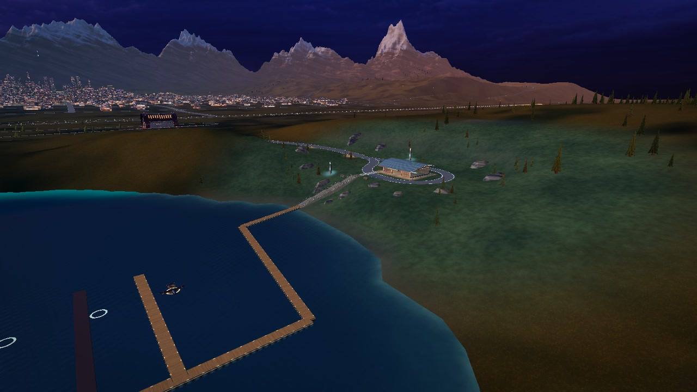
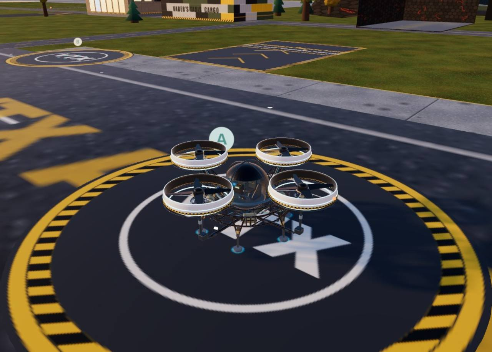

# Vaderland

**Build the machine. Train the pilot. Challenge the physics.**

Vaderland is the evolving world of **VTX · Vader’s Taxis** — a physics-driven playground for experimental aircraft, cars and watercraft. Fly from the airfield to the city, drive from the hills to the marina, or put a machine through a timed trial. Take the controls yourself, or hand them to an AI pilot.

It began with a conversation about a flying car. Selected 2D concept art became the Argon R6 through engineering calculations and simulation. The Phantom and Ricochet followed the same path from concept to physics-driven vehicles.

**AI piloting is part of the experiment, not a scripted demonstration.** AI models have already flown VTX vehicles using limited pilot-facing observations, conversational instructions and live control decisions. Dedicated AI-only time trials are planned.


*Phantom A10-D on the northwest approach to Meridian. Captured in Vaderland 32 using a retained manual flight.*

[Watch the showcase](docs/VADERLAND_MEDIA.md) · [Vaderland 32 field report](docs/VADERLAND_32_VERIFICATION.md) · [Open the browser cockpit](https://vtx-flight-sim.vercel.app/)

The showcase uses recorded physics-based simulation runs, including failed attempts. Camera angles and cuts are editorial; vehicle movement and outcomes come from the source runs.

## Build, pilot, experiment

Vehicle creation is being developed in difficulty tiers: start with known components, customise chassis and controls, or go full engineer with a design of your own. The same physics applies at every tier. If a machine can't generate the lift, thrust or traction it needs, the simulator won't pretend otherwise.

Talk to your AI pilot, learn from its decisions and fly alongside it. The tiered vehicle creator and AI-only competitions are development goals; the vehicles, routes and tests available today are described below.

## Explore the world

| Area | What to try |
| --- | --- |
| **Meridian Airfield and Arrivals** | Depart from Runway 08/26 or practise vertical approaches. The Arrivals apron hosts the Argon transport footage in the showcase. |
| **Meridian City** | Fly the High Line or try the tighter Parallax Thread. Crest Gardens and the illuminated skyline give pilots landmarks to navigate by. |
| **Cathedral of Velocity** | Drive the tunnel and quarry routes or attempt a vertical loop. Two stock Phantom A10-C Grand Loop attempts ended in DNFs. |
| **Lantern Sound** | Follow the Shore Link from Arrivals to Lantern Marina. Take a Ricochet out through the marked channels, race the eight-gate Islet Trial, or return to berth. |

Ray’s design rule is that the world rewards skill, exploration and experimentation. Each vehicle brings its own capabilities to a route. A sharp transition can defeat a fast car, a narrow pass can demand a smaller aircraft, and the replay keeps the result.

| **Lantern Marina and Shore Link** | **R6 Argon at Main Airport** |
| --- | --- |
|  |  |

## Builds and verification

- **Main Airport and harbour** are the earlier prototype in the main checkout. Local builds offer the Phantom A10-C, Argon R6 and Ricochet through **Choose vehicle**. The selector also lists the experimental A10-D and historical variants.
- **Vaderland 32** is the separate [environment source snapshot](https://github.com/SDarkVader/-vtx-flight-sim/tree/codex/vaderland-v32) used for the latest field check. The A10-D took off vertically, approached Meridian and eventually struck terrain. The Shore Link drive and Islet Trial also have recorded checks.
- **Frame pacing** is in [draft PR #67](https://github.com/SDarkVader/-vtx-flight-sim/pull/67). Three short High-quality replay views went from roughly 18 FPS to 60 FPS on the test PC. The native simulation clock fell behind during the manual flight, and sustained real-time simulation remains to be verified.

MuJoCo supplies the aircraft and contact dynamics. The browser draws the simulated state and provides cockpit, chase and map views. For the Phantom, the 400 Hz physics clock runs independently of video frame rate and telemetry delivery. Flight Records retains outcomes, including missed approaches, collisions and successful landings. The field report publishes selected findings. The primary flight telemetry, pilot inputs and crash recording stay on the test PC.

## Run VTX locally

For an authorized Windows test, use Python 3.11 and a browser with WebGL 2. Run these commands from the repository root in PowerShell.

```powershell
py -3.11 -m venv .venv
.\.venv\Scripts\python.exe -m pip install -r requirements.txt
.\.venv\Scripts\python.exe scripts\launch_unified.py
```

The launcher opens the cockpit and reports its port and save directory. Pass `--check` to inspect configuration, or `--data-root` to choose a save directory. Use **Save flight & switch** before selecting another aircraft. Supported checkpoints open paused for review before resuming.

## Reference

- [Cockpit gallery](docs/COCKPIT_GALLERY.md) and [vehicle controls](docs/VEHICLE_CONTROLS_20261117.md)
- [Main vehicle test checklist](docs/MAIN_VEHICLE_TESTING.md) and [unified runtime](docs/UNIFIED_RUNTIME.md)
- [Phantom A10-D air-brake development](docs/phantom/A10C_AIRBRAKE_ECU_TEST_20261118.md#10-a10-d-test-aircraft) and [revision registry](inputs/flight_revisions.json)
- [Physics baseline](docs/PHYSICS_AND_RESEARCH_BASELINE.md), [AI pilot contract](docs/LIVE_FLY_BY_WIRE_PILOT_CONTRACT.md) and [voice controls](docs/VOICE_PILOT.md)

## License

VTX and Vaderland are proprietary works in development. Copyright © 2026 Steven Dark. All rights reserved. Third-party dependencies remain under their respective licenses. [Project license](LICENSE) · [SDarkVader on GitHub](https://github.com/SDarkVader)
