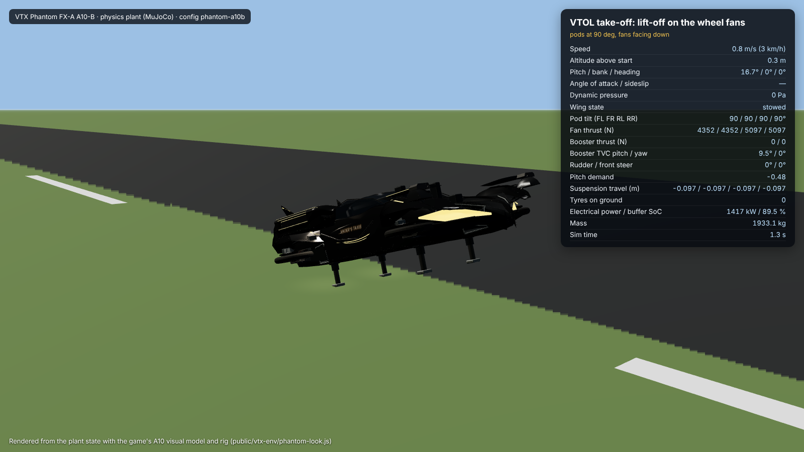
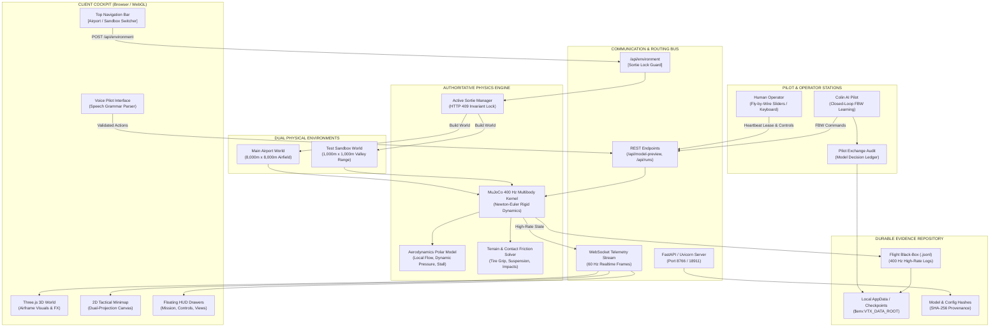

# VTX — Vader's Taxis: Experimental Flight Laboratory

> **"Build it. Fly it. Break it. Figure out why."**


**VTX** is a physics-driven 3D aerospace flight-test game and engineering proving ground set in the experimental hangar of *Vader's Taxis*. Step into the shoes of a test pilot and flight-test engineer: configure cutting-edge vertical takeoff (VTOL) and transforming aircraft, command real fly-by-wire flight surfaces, take off from active international airfields or rugged mountain test ranges, collaborate with an evolving AI copilot, and analyze real black-box flight data when things go sideways.

Every flight in VTX is governed by genuine **400 Hz Newton-Euler multibody physics** powered by MuJoCo. There are no invisible autopilot rails, scripted animations masquerading as flight, or rubber-band physics: mass, aerodynamic stall, rotor gyroscopic precession, actuator rate limits, tire friction, and structural loads decide whether your vehicle climbs out over the valley or impacts the tarmac.

> [!IMPORTANT]
> **Project Status & Proprietary Notice:** VTX is an experimental prototype and flight-test sandbox, **not a finished commercial release**. All original VTX game content, vehicle designs, CAD models, lore, and software code are proprietary. No commercial exploitation or unauthorized distribution is permitted without prior written consent. See [LICENSE](LICENSE).

---

## What You Can Do in VTX

Experience the exhilaration, unpredictability, and technical precision of experimental aviation.

### 1. Drive, Transform, and Fly
VTX lets you transition seamlessly across multiple operational modes in a single airframe:
* **Road Drive:** Steer along taxiways and service roads with functional front-wheel steer-by-wire, realistic suspension travel, and tire contact friction.
* **Wing Deployment:** Unfurl high-aspect wings from an internal split-level cassette behind the cabin. Mechanical interlocks lock deployment at speeds exceeding 25 m/s to protect against aeroelastic structural failure.
* **Vertical Takeoff (VTOL):** Tilt four ducted fan pods to 90°, spool up electric drive motors, and lift off vertically from pads, runways, or unprepared clearing sites.
* **High-Speed Cruise & Braking:** Fire twin rear booster propulsors, adjust the Drag Reduction System (DRS) flap, deploy raked fin rudders, and execute emergency 0.8g air-braking with downward-vectored fan pods.

```
          [ ROAD DRIVE ]               [ WING DEPLOYMENT ]              [ VTOL & CRUISE ]
      Front steer-by-wire,         High-aspect wings slide from     90° tilting ducted fans,
       suspension travel,          fuselage cassette; locked at     twin boosters & canards;
        tarmac tire grip               airspeeds > 25 m/s            0.8g vectored air brake
```


---

### 2. Choose Your Proving Ground (Selectable Live Worlds)
Switch instantly between two distinct, high-fidelity physical environments directly from the cockpit header:

* **Main Airport (8,000 × 8,000 m):** A full-scale commercial airfield featuring dual 3,000 m parallel runways, high-speed taxiways, terminal gate complexes, ramp areas, a central control tower, and procedural approach lighting. Ideal for high-speed transition runs, long climbs, and crosswind landings.
* **Test Sandbox — Stage 1 Valley (1,000 × 1,000 m):** An enclosed tactical test range nestled within a rugged mountain canyon. Features natural terrain obstacles, a winding river water hazard, perimeter radar fences, and precision rooftop landing pads (Pads A, B, and C). Perfect for low-altitude hover agility and emergency obstacle avoidance.

> [!NOTE]
> Environment switching in VTX is a **true physical terrain swap**, not a cosmetic skybox. Swapping between Airport and Sandbox reloads MuJoCo collision heightfields, rebuilds ground contact geometry, updates the 2D tactical radar minimap, and computes a fresh SHA-256 model fingerprint.


---

### 3. Pilot the Hangar Fleet

| Aircraft Variant | Class / Architecture | Distinctive Flight Capabilities | Historic Milestone / Provenance |
| :--- | :--- | :--- | :--- |
| **Phantom A10-B** *(Default)* | Two-seat transforming aerocar (FX-A) | 7° wing incidence, active front-wheel steering, Munk hull lift, Moog 965 actuator models, twin rear boosters, DRS flap | Production standard; verified 0.8g air-brake and fan-assisted turns |
| **Phantom A10-A** | Baseline VTOL prototype | Retractable cassette wings, 4 wheel-pod fans, fixed P6 stabilator | 72-sortie November campaign benchmark (peak altitude 600.58 m) |
| **R6 Argon** | Four-pod ducted quadrotor | 4 independently articulated ducted fan pods, annular primary structure | Foundation testbed; pure hover agility and dynamic station-keeping |
| **Phantom A10 As-Drawn** | Scale CAD concept | Compact Ø0.49 m fan geometry (thrust-to-weight 0.52) | Educational study frame demonstrating hover deficit |
| **R4 / R5 Study Frames** | Aerodynamic test mules | Lightweight tubular airframes with variable mass distributions | Inertia screening and ground-resonance validation |



---

### 4. Fly with Colin (The Evolving AI Pilot) & Voice Control
VTX is engineered around genuine human-machine collaboration:
* **The AI Pilot Contract:** Meet **Colin**, an AI copilot that interacts with the aircraft through the exact same fly-by-wire controls and sensory observations available to a human pilot. Colin does not use cheat codes, invisible route followers, or pre-baked trajectories; he observes airspeed, pitch, roll, and altitude, issues actuator commands, experiences the physical consequences, and learns through trial, error, and recovery.
* **Push-to-Talk Voice Commands (🎙 Voice):** Speak naturally into your microphone (in Chrome or Edge) to issue tactical flight commands (*"gear down"*, *"deploy wings"*, *"rotate pods vertical"*, *"climb fifty meters"*). Voice audio is parsed against a deterministic aerospace grammar; critical safety maneuvers require a clear verbal *"confirm"* before execution.
* **Dual Authority Handover:** Pass control authority back and forth seamlessly between human manual inputs and Colin during any phase of flight.

---

### 5. Investigate Crashes & Audit Flight Evidence
In VTX, a crash is not a "game over" screen—it is primary flight-test data.
* **400 Hz Telemetry Black Box:** Every sortie records high-frequency sensor readings, control surface demands, battery state-of-charge, engine thermal dissipation, and structural loads.
* **2D Tactical Minimap:** Track your real-time ground track, velocity vector, altitude tape, and pad clearances on a custom vector radar canvas.
* **The 7-Gate Flight Test Dashboard (`/dashboard/`):** Evaluate completed sorties against strict aerospace validation gates. Review post-crash structural failure points, pilot audit logs, and diagnostic telemetry to adjust your airframe parameters for the next flight.


---

## The Unified Three-Panel Cockpit

VTX integrates three complete operational workstations into a single high-performance browser interface:

```
+=======================================================================================================+
| VTX AEROSPACE proving ground · [AIRPORT] [SANDBOX] · Phantom A10-B · SORTIE STANDBY                    |
+====================================+==================================+===============================+
| PANEL 1: LIVE COCKPIT              | PANEL 2: FLIGHT TEST DASHBOARD   | PANEL 3: PHYSICS EXPERIMENTS  |
|                                    |                                  |                               |
| • 60 FPS Three.js 3D Viewport      | • Embedded Suite (`/dashboard/`) | • Independent MuJoCo Kernel   |
| • Tactical Minimap Radar (Canvas)  | • 7 Evidence Certification Gates | • Custom Mass/Inertia Sliders |
| • Floating HUD Drawers:            | • Historical Sortie Archives     | • Aerodynamic Polar Overrides |
|   - Mission: Origin & Destination  | • Black-Box JSONL Telemetry      | • Automated Batch Monte Carlo |
|   - Controls: Fly-by-wire & Voice  | • Failure Cause Classification   | • Downloadable Evidence Packs |
|   - Views: Cockpit / Orbit / Tower | • Checkpoint Restoration Engine  | • SHA-256 Provenance Fingerprint|
+====================================+==================================+===============================+
```

1. **Live Cockpit (`/`):** The primary flight station. Direct WebGL window into the simulation with interactive camera views (Cockpit 1st-person, Chase, Orbit, Tower, Runway Threshold) and floating tactical HUD drawers.
2. **Flight Test Dashboard (`/dashboard/`):** The flight operations center. Inspect every historical sortie, review certified evidence gates, download raw telemetry streams, and inspect pilot reasoning logs.
3. **Physics Experiments (`/experiments/`):** The engineering skunkworks. Run isolated simulation runs with experimental mass allocations, altered center-of-gravity offsets, custom aerofoil polars, and synthetic engine limits without corrupting active flight data.

---

## Architectural Blueprint

The VTX architecture pairs a lightweight, zero-compilation WebGL cockpit with an authoritative, high-rate physical simulation kernel.



---

## Core System Rules & Physics Invariants

To preserve scientific rigor, every component of VTX adheres to strict system-level rules:

1. **Rule 1: Single Source of Truth:**
   Visual rendering is strictly a downstream consumer of the physical state. No visual script, camera matrix, or user action may alter aircraft coordinates, suppress an impact, cancel a stall, or force a stable landing.
2. **Rule 2: Active Sortie Lock (HTTP 409):**
   The simulation world cannot be swapped while an aircraft is airborne or while a sortie checkpoint is unrecovered. Attempts to alter the environment during flight return an explicit HTTP 409 Conflict, preserving data integrity.
3. **Rule 3: Crash-Consistent Durable Evidence:**
   Every sortie is tagged with a unique ISO 8601 run ID and SHA-256 model fingerprint. Crashes, mechanical jams, and actuator saturations are preserved as definitive test results. Deleting or overwriting failed runs is strictly forbidden.
4. **Rule 4: Command Lease & Automatic Feathering:**
   Pilot commands operate on a 500 ms heartbeat lease. If manual input or AI telemetry connection is lost, controls automatically feather to a safe neutral position to prevent runaway actuators.
5. **Rule 5: Release Guard & Aeroelastic Safeguards:**
   Actuator limits and structural locks prevent impossible aerodynamic operations. Wing deployment commands issued at airspeeds exceeding 25 m/s are rejected by the flight-control computer to prevent spar failure.
6. **Rule 6: Strict Design System Uniformity:**
   Cockpit user interfaces, floating panels, radar canvases, and tactical readouts follow the aerospace token specifications defined in [`DESIGN_SYSTEM_RULES.md`](DESIGN_SYSTEM_RULES.md).

---

## DevLog: From Hangar Sketches to Dual-World Simulation

* **Milestone 1 — Ducted Quad Foundations (October 2026):**
  Engineered the initial R4, R5, and R6 Argon testbeds. Implemented 400 Hz MuJoCo multibody kinematics, four independently articulated ducted fan pods, and baseline ground-effect contact mechanics.
* **Milestone 2 — Digital Airframe & The Colin Experiment (Nov 1–3, 2026):**
  Integrated the Blendstra P0-V4 CAD geometry into a unified physics model. Defined the [Live Fly-By-Wire Pilot Contract](docs/LIVE_FLY_BY_WIRE_PILOT_CONTRACT.md), introducing Colin—an AI copilot that learns by physical experience without pre-baked path assists.
* **Milestone 3 — The 72-Sortie Phantom A10-A Campaign (Nov 4–7, 2026):**
  Executed a 72-flight automated test campaign with the initial Phantom prototype (`70089cca`), achieving a peak altitude record of 600.58 m. Validated cassette wing extension mechanics while uncovering low-speed hover power deficits and hub drive limits.
* **Milestone 4 — Phantom A10-B Evolution (Nov 8–9, 2026):**
  Engineered the A10-B variant (`3ecae1a9`): added 7° wing incidence, active steer-by-wire front suspension, Munk hull lift polars, Moog Model 965 actuator dynamic models, and verified high-speed 0.8g fan-vectored deceleration.
* **Milestone 5 — Unified Three-Panel Cockpit & Dual Environments (Current):**
  Combined the 3D Live Cockpit, 7-Gate Flight Test Dashboard, and Independent Physics Experiments into a single-origin web workspace. Added real-time environment switching between the 8 km Main Airport and the 1 km Stage 1 Valley Sandbox with full MuJoCo terrain recreation.

---

## Quickstart: Starting the Simulator

### Prerequisites
* Windows 10/11 64-bit
* Python 3.11+ with `pip`
* A modern browser with WebGL 2.0 (Google Chrome or Microsoft Edge recommended for voice commands)

### Launching with the PowerShell Launcher
From the repository root, launch the integrated development server with automatic port validation and data directory provisioning:

```powershell
# Run the automated development launcher on default port 18911
powershell -ExecutionPolicy Bypass -File .\RUN_THREE_PANEL_DEV.ps1 -Port 18911
```

### Manual Startup via Uvicorn
Alternatively, start the server directly using your Python environment:

```powershell
python -m pip install -r requirements.txt
$env:PYTHONPATH = 'src'
$env:VTX_DATA_ROOT = "$env:LOCALAPPDATA\VTX\unified-dashboard"
python -m uvicorn vtx.dashboard_site:app --host 127.0.0.1 --port 8766
```

Open your browser to: **[http://127.0.0.1:8766/](http://127.0.0.1:8766/)** (or port `18911`).

---

## Cockpit Flight Controls Reference

| Control Input | Keyboard Shortcut | Function & Behavior |
| :--- | :--- | :--- |
| **Pitch** | `W` / `S` or `Up` / `Down` | Forward/aft elevator and canard pitch trim |
| **Roll** | `A` / `D` or `Left` / `Right` | Differential aileron deflection and pod tilt |
| **Yaw** | `Q` / `E` | Raked twin fin rudders and differential booster thrust |
| **Collective Thrust** | `Shift` / `Ctrl` | Master ducted fan collective lift demand |
| **Pod Tilt** | `[` / `]` | Pivot ducted fan pods (0° forward flight ⟷ 90° VTOL hover) |
| **Road Steer** | `A` / `D` *(on ground)* | Steer-by-wire front wheels with active Ackerman geometry |
| **Wing Deploy / Stow** | Click in **Controls HUD** | Slide wings from cassette (requires airspeed < 25 m/s) |
| **Camera View** | `C` | Cycle Cockpit 1st-person, Chase, Orbit, and Tower views |
| **Voice Push-to-Talk**| Click & hold **🎙 Voice** | Spoken tactical commands (*"gear down"*, *"abort"*) |

---

## Engineering Documentation & Design Specs

* **[Design System Rules](DESIGN_SYSTEM_RULES.md):** Complete specifications for UI tokens, color palettes, typography, Three.js asset pipelines, and DOM component patterns.
* **[Phantom A10-B Model Specification](docs/phantom/PHANTOM_A10B_MODEL.md):** Aerodynamic polars, mass breakdown, actuator travel limits, and power distribution.
* **[Live Fly-By-Wire Pilot Contract](docs/LIVE_FLY_BY_WIRE_PILOT_CONTRACT.md):** Strict architectural requirements for human and AI closed-loop control.
* **[Physics & Research Baseline](docs/PHYSICS_AND_RESEARCH_BASELINE.md):** The underlying equations of motion, momentum bounds, and verification benchmarks.
* **[Flight Index](docs/FLIGHT_INDEX.md):** Master catalog of historical sorties and black-box data archives.

---

## Licensing & Credits

Copyright © 2026 Steven Dark (SDarkVader). **All rights reserved.**<br>
VTX is proprietary software and game intellectual property. Third-party packages (MuJoCo, Three.js, FastAPI) remain subject to their respective open-source licenses. For developer collaborations or licensing inquiries, contact [SDarkVader on GitHub](https://github.com/SDarkVader).
