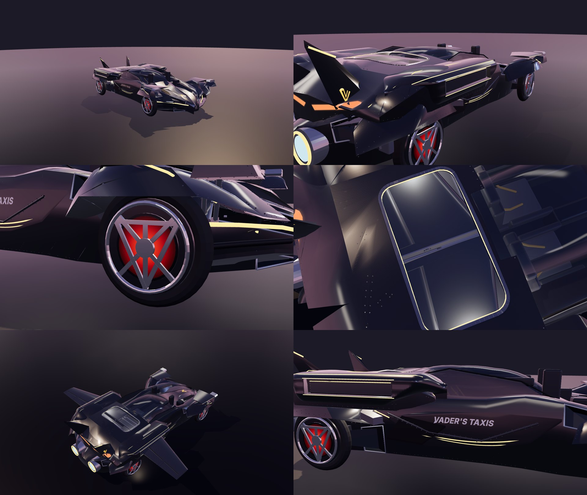
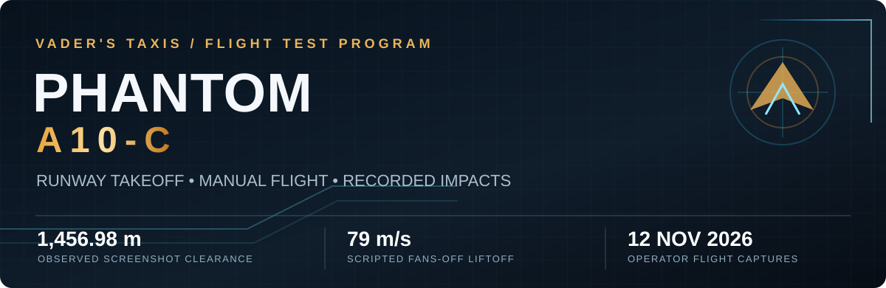
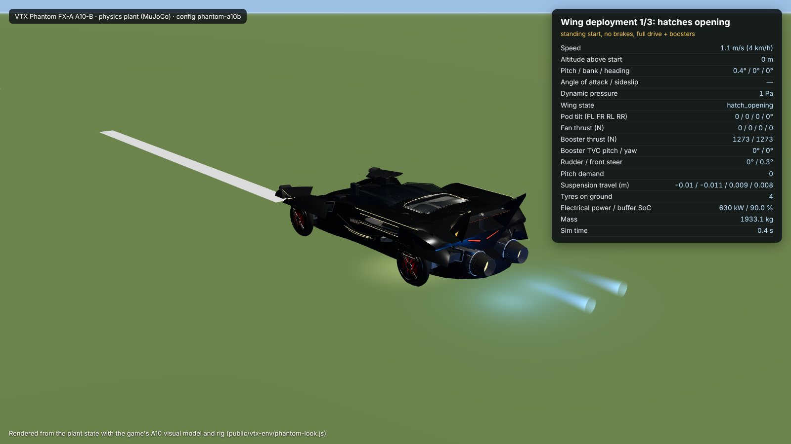
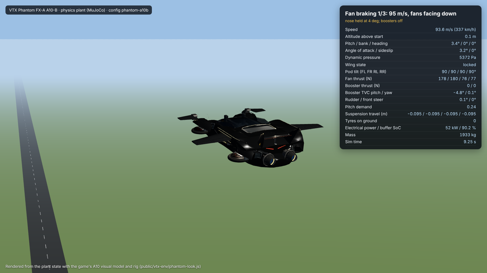
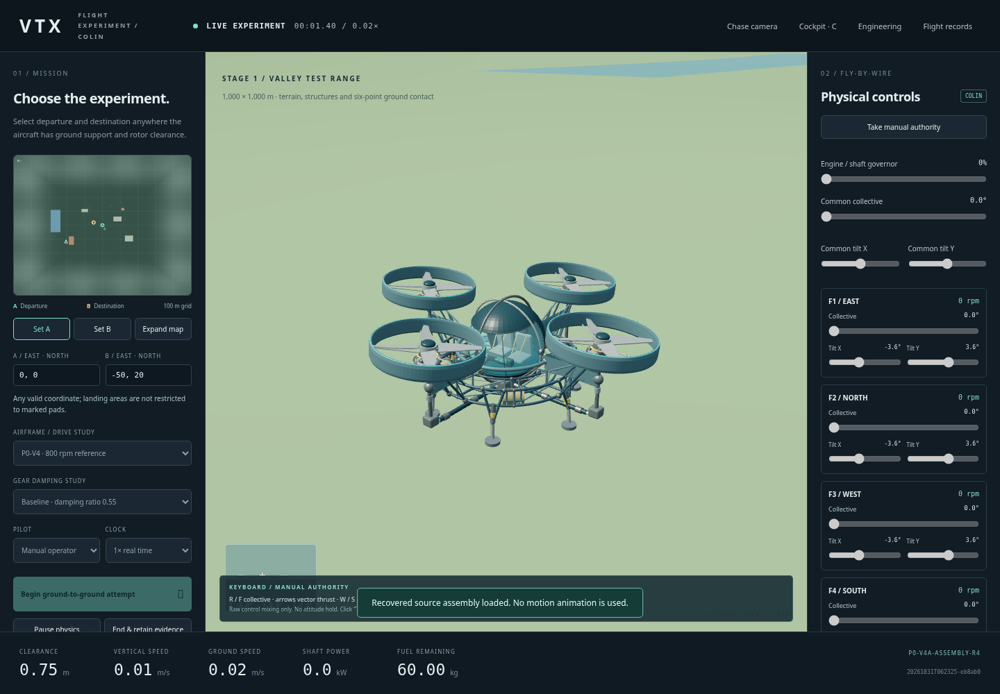

<div align="center">

# VTX — VADER'S TAXIS
### Experimental flight laboratory

**BUILD IT. FLY IT. BREAK IT. FIGURE OUT WHY.**



*Design the machine. Take the controls. Let the physics answer.*

</div>

**VTX** is an independent, physics-driven flight simulator and aerospace engineering sandbox. It combines original transforming aircraft, a live 3D cockpit, a MuJoCo dynamics model, hands-on controls, AI pilot interfaces and flight-test evidence in one place.

There is no predetermined takeoff animation to rescue a poor design: the aircraft must generate forces, respond to control inputs and survive contact with the world. A successful departure is evidence. So is the crash.

> [!IMPORTANT]
> **Development prototype, not an airworthiness-certified simulator.** VTX models physical mechanisms and records their simulated behaviour; aerodynamic fidelity, controls and numerical assumptions still need verification. The [project licence](LICENSE) governs use of the original code and designs.

---

## ✦ New flight milestone — Phantom A10-C



The **Phantom FX-A A10-C** is an experimental development variant of the transforming Phantom. It adds a higher-thrust turbojet option and actuated nose-strut takeoff stance to the A10-B engineering baseline. **A10-B remains the identity-pinned default**; A10-C development is not being represented as a production aircraft.

**12 November 2026 — manual flight testing.** In operator-supplied cockpit captures and flight footage, A10-C has been flown above the airport and terrain, turned, decelerated, climbed, descended and ultimately impacted the ground. These are observed simulator behaviours, not claims of airworthiness or a fully validated flight envelope.

| Captured evidence | Result | What it means |
| :--- | ---: | :--- |
| Highest supplied A10-C clearance screenshot | **1,456.98 m** | At least this terrain clearance was displayed; **not** a verified campaign maximum |
| Climbing screenshot | **+14.31 m/s** vertical speed | Substantial positive climb rate at that instant |
| Slow horizontal-motion screenshot | **0.18 m/s** ground speed | Near-zero translation **while climbing**, not a proven altitude-hold hover |
| Earlier scripted A10-C fans-off runway test | **79 m/s** lift-off | Wheels-off in the live MuJoCo test with lift fans at 0 rpm; about 1 km ground roll |

The operator flight also shows coordinated manual handling of canards, yaw/bank, collective and forward thrust. The final recorded impact is part of the evidence, not grounds to ignore the preceding flight.

**Explore the evidence:** [A10-C operator flight notes — 12 Nov](docs/phantom/A10C_OPERATOR_FLIGHTS_20261112.md) · [A10-C fans-off takeoff study — 11 Nov](docs/phantom/A10C_FANS_OFF_TAKEOFF.md)

> **Evidence boundary:** The manual-flight screen captures, video and raw JSONL are not yet archived with this README. The 79 m/s fans-off study and later manual flights are **separate tests**. Do not assume the same propulsion settings or combine readings from separate screenshots into a single flight trace.

---

## The hangar

| Vehicle | Role | Current state |
| :--- | :--- | :--- |
| **Phantom FX-A A10-C** | Turbojet development aerocar; wings, canards, differential controls, lift-fan hardware | Scripted fans-off takeoff demonstrated; later piloted climb and manoeuvring captured; landing and full-envelope validation outstanding |
| **Phantom A10-B** | Identity-pinned default Phantom; steerable wheels, deployable wings, boosters, fan-vector control | Canonical engineering baseline and existing visual mesh |
| **Phantom A10-A** | Earlier transforming VTOL test vehicle | Historical prototype with a documented multi-sortie flight campaign |
| **R6 Argon** | Four-pod vectored-fan testbed | Hover, station-keeping and A-to-B experimental development platform |

More vehicles can join the lab as their models and evidence mature. The **Ricochet RC-01** is part of the wider design work, not presented here as a validated flight-ready option.

<div align="center">



<sub>Existing A10-B development imagery. The A10-C currently reuses its visual GLB; these are not photographs of A10-C test runs.</sub>
</div>

---

## What you can do

**Fly the machine.** Take off conventionally or vertically where the selected vehicle allows, adjust control surfaces, coordinate pitch/roll/yaw, manage propulsors and experience stalls, loss of control, terrain contact and crashes through the simulation rather than a canned flight sequence.

**Explore two worlds.** The **Main Airport** is an approximately 8 km × 8 km working test environment with runways, taxiways, approaches and surrounding terrain. The **Test Sandbox** is a separate valley and obstacle range. World selection changes the physical terrain and contact environment, not just the background.

**Bring an AI pilot.** The project includes a human/AI fly-by-wire command interface, voice-command work and an evolving **Colin** pilot integration. Commands and observations are part of the same instrumented system; integration and supported commands may vary by branch.

**Investigate everything.** Sortie telemetry, model fingerprints, control outputs, impacts and flight-test records support comparisons between configurations. Failed runs remain useful evidence.



---

## Under the skin

| System | Purpose |
| :--- | :--- |
| **MuJoCo physics** | 400 Hz configured multibody dynamics, aerodynamic forces, propulsion and terrain contact |
| **Browser cockpit** | Three.js aircraft/world visualisation, HUD, tactical map and manual controls |
| **Flight-test dashboard** | Experiments, recorded flights and engineering evidence |
| **AI / voice interface** | Pilot commands through defined control and observation routes |
| **Flight records** | Time-stamped telemetry and configuration provenance |

**The physics state is authoritative; the renderer follows it.** That is the central design rule. Model correctness is still tested rather than assumed, especially around aerodynamic polars, crossflow, power limits and flight-control authority.

For architecture, testing and reproducibility, see the [physics baseline](docs/PHYSICS_AND_RESEARCH_BASELINE.md), [live fly-by-wire contract](docs/LIVE_FLY_BY_WIRE_PILOT_CONTRACT.md) and [flight index](docs/FLIGHT_INDEX.md).

---

## Start flying locally

**Requirements:** Windows 10/11, Python **3.12+**, and a modern WebGL-capable browser.

```powershell
git clone https://github.com/SDarkVader/-vtx-flight-sim.git
cd .\-vtx-flight-sim
.\launch-windows.bat
```

The launcher creates a local Python environment if needed, checks dependencies and starts the simulator on an available local port. Open the address printed in the terminal. Each checkout uses its own data directory so one simulator's pending flight record does not overwrite another's.

**Developer options:** [Three-panel development launcher](RUN_THREE_PANEL_DEV.ps1) · [Design system](DESIGN_SYSTEM_RULES.md)

---

## Engineering log & documentation

- [A10-C operator flights — 12 November 2026](docs/phantom/A10C_OPERATOR_FLIGHTS_20261112.md) — observed climb, deceleration and impact; evidence limits.
- [A10-C fans-off takeoff study](docs/phantom/A10C_FANS_OFF_TAKEOFF.md) — scripted runway tests, propulsion and CG assumptions.
- [A10-B model specification](docs/phantom/PHANTOM_A10B_MODEL.md) — canonical parameters and actuator studies.
- [Flight record index](docs/FLIGHT_INDEX.md) — indexed prior sorties; full local telemetry is separate.
- [Flight-test dashboard and integration](docs/UNIFIED_RUNTIME.md) — runtime and architecture notes.

**12 Nov integration note:** A10-C cockpit changes remain under review in [PR #45](https://github.com/SDarkVader/-vtx-flight-sim/pull/45) and [PR #46](https://github.com/SDarkVader/-vtx-flight-sim/pull/46). The README documents observed development capabilities without claiming those open changes are merged into `main`.

---

<div align="center">

**VTX — VADER'S TAXIS**

*No invisible rails. No free lift. Every flight tells you something.*

<sub>© 2026 Steven Dark / SDarkVader · Original VTX software, designs, vehicles and lore are proprietary. Third-party dependencies retain their own licences.</sub>

</div>
