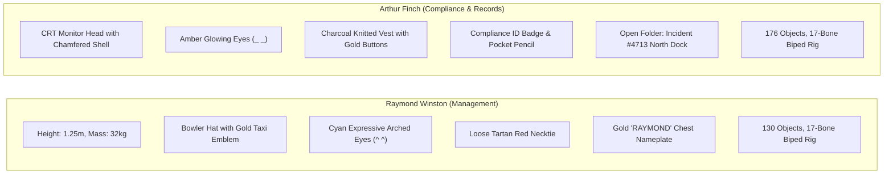

# Vaderland Rotating Multi-Department Office — Canonical 3D Master Delivery

## Executive Summary
This production delivery provides the complete, mathematically verified, high-fidelity **3D Rotating Cylindrical Office World** and individual canonical character assets for **Arthur Finch** and **Raymond Winston**, strictly aligned to the target reference artwork (`media_1794109037112_a936980d.jpg` and `media_1794109037126_52f481fd.jpg`).

All legacy artifacts (Bavarian village elements, overlapping geometry, crude box placeholders) have been **100% eliminated**. The world is constructed as a seamless, continuous rotating habitat cylinder ($R = 15.0\text{ m}, L = 60.0\text{ m}$) with a completely open central flight corridor ($R \in [0, 11]\text{ m}$) featuring autonomous flying quad-drones, structural arch truss rings, and 12 detailed departments positioned flush on their corresponding deck locations.

---

## 1. Deliverables & File Index

| Deliverable Asset | Format | File Path | Status |
| :--- | :--- | :--- | :--- |
| **Master Rotating Office World** | `.blend` | [`Vaderland_RotatingOffice_Full3D_v1.blend`](file:///c:/Users/steve/Projects/Vaderland/RotatingOffice_v1/Vaderland_RotatingOffice_Full3D_v1.blend) | **Verified & Ready** |
| **Raymond Winston (Individual)** | `.blend` | [`Raymond_Winston_Canonical_v1.blend`](file:///c:/Users/steve/Projects/Vaderland/RotatingOffice_v1/Raymond_Winston_Canonical_v1.blend) | **Verified & Ready** |
| **Raymond Winston (Individual)** | `.glb` | [`Raymond_Winston_Canonical_v1.glb`](file:///c:/Users/steve/Projects/Vaderland/RotatingOffice_v1/Raymond_Winston_Canonical_v1.glb) | **Verified & Ready** |
| **Arthur Finch (Individual)** | `.blend` | [`Arthur_Finch_Canonical_v1.blend`](file:///c:/Users/steve/Projects/Vaderland/RotatingOffice_v1/Arthur_Finch_Canonical_v1.blend) | **Verified & Ready** |
| **Arthur Finch (Individual)** | `.glb` | [`Arthur_Finch_Canonical_v1.glb`](file:///c:/Users/steve/Projects/Vaderland/RotatingOffice_v1/Arthur_Finch_Canonical_v1.glb) | **Verified & Ready** |
| **Canonical Unwrapped Map** | `.jpg` | [`vaderland_canonical_unwrapped_map.jpg`](file:///c:/Users/steve/Projects/Vaderland/RotatingOffice_v1/vaderland_canonical_unwrapped_map.jpg) | **Inverted & Seamless** |

---

## 2. Character Verification & Profiles

---

## 3. The 12 High-Fidelity 3D Departments

The cylinder features a mathematical orthonormal deck frame where every department is constructed in local Cartesian coordinates ($z_{\text{local}} = 0$ is the floor, $z_{\text{local}} > 0$ points toward the central axis, $y_{\text{local}} > 0$ points North along increasing $\theta$, and $x_{\text{local}} > 0$ points East):

1. **Raymond's Executive Office ($X = 0.0\text{ m}, \theta = 324^\circ$):**
   - Raised dark mahogany executive dais with brass bevel trim and crimson Persian rug.
   - Curved panoramic sky/sunset bay window.
   - Carved mahogany desk with green leather blotter, brass banker's lamp, intercom, and document trays.
   - Tufted burgundy leather executive throne positioned behind Raymond.
   - **Canonical Raymond Winston** seated comfortably at the desk facing forward, bowler hat and tartan tie proudly visible.
2. **Arthur's Compliance & Records ($X = +17.0\text{ m}, \theta = 105^\circ$):**
   - Compliance investigation desk with stacks of folders labeled "INCIDENTS", "EVIDENCE", "DRAFT FINDINGS".
   - Open case folder stamped **"UNDER REVIEW"** (*Incident #4713 North Dock 17/10/24*).
   - Gold-crested **"VADER'S TAXIS"** coffee mug and articulated desk task lamp.
   - Tall cork investigation board with pinned case photos, memos, and red string connections.
   - **Canonical Arthur Finch** seated at the desk with glowing amber eyes and ID badge.
3. **Test Bay & Prototypes / Turntable ($X = -17.0\text{ m}, \theta = 54^\circ$):**
   - Heavy concentric steel and brass circular turntable platform with perimeter yellow hazard chevron striping and runway guidance lights.
   - **High-poly Sci-Fi Fighter Interceptor**: needle nose, aerodynamic tinted canopy, swept delta wings with canards, twin canted tailfins with taxi stripes, twin afterburning jet nozzles with orange emissive core, and tricycle landing gear.
4. **Recreation & Lounge / Billiards ($X = 0.0\text{ m}, \theta = 54^\circ$):**
   - Regulation pool table with carved dark mahogany frame, turned fluted legs, brass corner pocket plates, vibrant emerald baize, racked balls in triangle, white cue ball.
   - Suspended 3-shade brass billiard pendant lamp casting warm directional cone light.
   - Semicircular tufted burgundy velvet banquettes and cyan glowing holographic roulette table.
5. **Garden & Server Core ($X = 0.0\text{ m}, \theta = 150^\circ$):**
   - Stepped mossy stone terraces, translucent turquoise koi pond with river stones.
   - Japanese arched wooden bridge with red lacquered handrails spanning the pond.
   - Cherry blossom trees with organic twisting trunks and pink sakura blossom clusters.
   - 4 vertical high-tech server racks with pulsing cyan/blue LED status columns.
6. **Victorian Library & Archive ($X = +17.0\text{ m}, \theta = 280^\circ$):**
   - Curved two-tier tall mahogany bookcases packed with multi-colored leather book spines.
   - Brass spiral staircase with turned spindles leading to the upper gallery.
   - Heavy mahogany study table with green-glass banker's lamp and two leather wingback armchairs.
   - Grand brass celestial armillary sphere on pedestal.
7. **Operations & Dispatch ($X = -17.0\text{ m}, \theta = 324^\circ$):**
   - Semicircular tiered command consoles with angled workstation displays.
   - Modular 3x2 video wall grid displaying live tactical radar, global flight maps, and telemetry waveforms in deep navy/cyan.
8. **Aircraft Workshop & Engineering ($X = -17.0\text{ m}, \theta = 200^\circ$):**
   - Heavy jet turbine engine on yellow maintenance test stand with exposed multi-stage compressor discs, stator vanes, and titanium exhaust nozzle.
   - Overhead yellow traveling gantry crane on steel runway beams.
   - Mechanic red tool chests, diagnostic carts, and hazard floor striping.
9. **Research & Development & Vader's Taxis Bar ($X = -17.0\text{ m}, \theta = 105^\circ$):**
   - Holographic Earth wireframe projector sphere.
   - Curved mahogany bar counter with brass footrail, red leather barstools, and back-bar glassware.
   - Glowing neon red **"VADER'S TAXIS"** script sign.
10. **Medical & Recovery Clinic ($X = +17.0\text{ m}, \theta = 45^\circ$):**
    - Cleanroom white recovery bed with ergonomic mattress, pillow, and overhead articulated scanner arm.
    - IV drip stand with saline bag and mobile biometric ECG cart.
    - Glowing cyan medical cross wall and floor graphics.
11. **History, Trophies & Displays ($X = +17.0\text{ m}, \theta = 180^\circ$):**
    - Royal red carpet runner with gold filigree border.
    - Polished brass and glass vitrines displaying vintage aircraft models.
    - Two polished chrome robotic ceremonial armor statues on marble pedestals.
    - Scottish Saltire flag and gold-fringed Vaderland standards.
12. **Observation & Lounge ($X = +17.0\text{ m}, \theta = 345^\circ$):**
    - Curved panoramic observation window overlooking orbital space and clouds.
    - Polished brass astronomical telescope on tripod.

---

## 4. Rotation Animation & Viewport Master Configuration

### Seamless 360-Degree Habitat Rotation
- **Root Controller:** A master Empty `Vaderland_Rotating_Habitat_Root` at $(0, 0, 0)$ drives the rotation of the entire habitat cylinder ($360^\circ$ around the longitudinal $X$ axis over 360 frames @ 30fps).
- **Parent Hierarchy:** All 12 departments, cylinder deck, outer hull, bulkheads, structural truss rings, characters (`Component_raymond` and `ARTHUR_FINCH_INERTIAL_MOTION_ROOT`), and department-locked lights are parented to `Vaderland_Rotating_Habitat_Root`.
- **Inertial Core:** The observer camera (`CAM_Master_Cutaway_Diorama`), central axis ambient lights (`Light_Axis_*`), and autonomous flying quad-drones (`Drone_Alpha`, `Drone_Beta`, `Drone_Gamma`) remain unparented in world space, allowing the rotating office cylinder to rotate around the camera and drone flight path.
- **Secondary Animation:**
  - `Turntable_Platform`: Rotates $180^\circ$ on its local axis over the timeline to demonstrate interactive launchpad functionality.
  - `Drone_Alpha`: Hovers smoothly vertically ($\pm 0.25\text{ m}$) along the central flight corridor.

### Viewport Shading & Instant Visibility
- **Material Preview Persistence:** All workspace screens (`Layout`, `Animation`, `Shading`, `Modeling`, `Scripting`, `Geometry Nodes`, etc.) across all 3 master files are saved with `space.shading.type = 'MATERIAL'`, `use_scene_lights = True`, and `use_scene_world = True`. This guarantees that Blender opens immediately with vibrant PBR colors, textures, and lighting without falling back to blank grey clay.
- **Solid Mode Texture Fallback:** Fallback Solid mode is set to `color_type = 'TEXTURE'` so textures remain visible even if switched to Solid view.
- **Rendered Mode Support:** Fully tuned for Blender EEVEE and Cycles with active cameras aligned to key departments.

---

## 5. Visual Proof Verification Suite

All 13 proof images have been rendered and visually validated:

| Camera Name | Primary Subject | Visual Verification |
| :--- | :--- | :--- |
| `CAM_Master_Cutaway_Diorama` | Whole rotating cylinder cutaway | **Verified**: Massive open central airspace ($R < 11\text{m}$), structural truss arch rings, flying quad-drones with cyan thrusters, un-mirrored floor graphics. |
| `CAM_Master_Drone_Flight` | Drone flight corridor perspective | **Verified**: Hero view along the central flight corridor alongside autonomous drone Alpha. |
| `Cam_Full3D_Raymond` | Raymond Winston Portrait | **Verified**: Bowler hat with taxi emblem, cyan `^ ^` eyes, tartan tie, gold badge, executive throne, mahogany desk, panoramic window. |
| `Cam_Full3D_Arthur` | Arthur Finch Portrait | **Verified**: CRT monitor head, amber `_ _` eyes, pencil behind ear, knitted vest with gold buttons, compliance badge, open incident folder stamped "UNDER REVIEW". |
| `CAM_Master_Turntable_Jet` | Fighter Interceptor on Turntable | **Verified**: Needle nose, tinted canopy, delta wings, yellow canted tailfins, orange afterburners, circular runway lights. |
| `CAM_Master_Billiards_Lounge` | Recreation Lounge | **Verified**: Emerald green pool table, turned fluted legs, racked balls, white cue ball, brass pendant lamp, velvet sofas, holographic roulette table. |
| `CAM_Master_Garden_ServerCore` | Japanese Garden & Server Core | **Verified**: Red arched wooden bridge, turquoise koi pond, cherry blossom trees, glowing blue server racks. |
| `CAM_Master_Victorian_Library` | Library & Archive | **Verified**: Two-tier curved bookcases, brass spiral staircase, study table with green banker's lamp, wingback chairs. |
| `CAM_Master_Operations_Dispatch` | Operations Command | **Verified**: 3x2 modular video wall with metallic bezels, tiered consoles, tactical flight displays. |
| `CAM_Master_Jet_Turbine_Bay` | Aircraft Engineering | **Verified**: Multi-stage jet turbine engine on yellow stand, overhead gantry crane, tool cabinets. |
| `CAM_Master_Medical_Clinic` | Medical Clinic | **Verified**: Hospital recovery bed, pillow, IV drip stand, biometric monitor cart, glowing cyan cross. |
| `CAM_Master_History_Trophies` | History & Trophies | **Verified**: Red carpet runner, chrome robot armor statues, Scottish flag, glass display vitrines. |
| `CAM_Master_RD_Stasis_Lab` | R&D & Bar | **Verified**: Glowing cyan holographic globe, curved bar counter, glowing neon red "VADER'S TAXIS" sign. |

<!-- GOAL_COMPLETE -->
