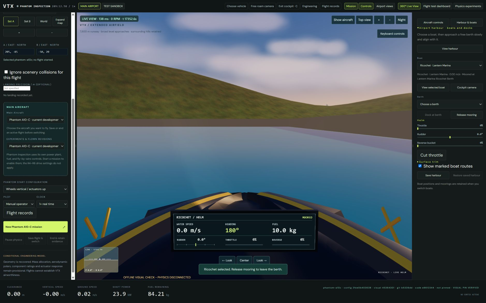
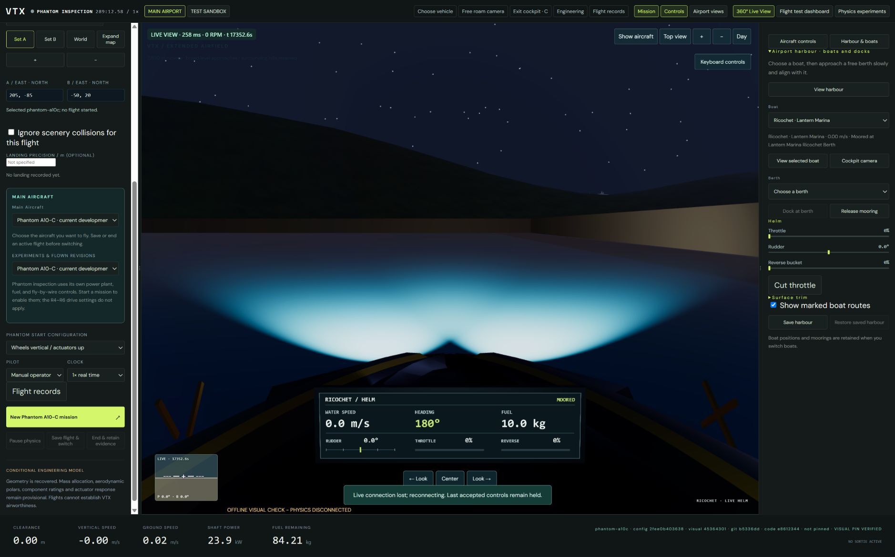
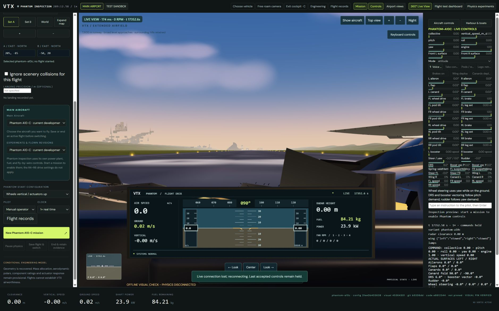
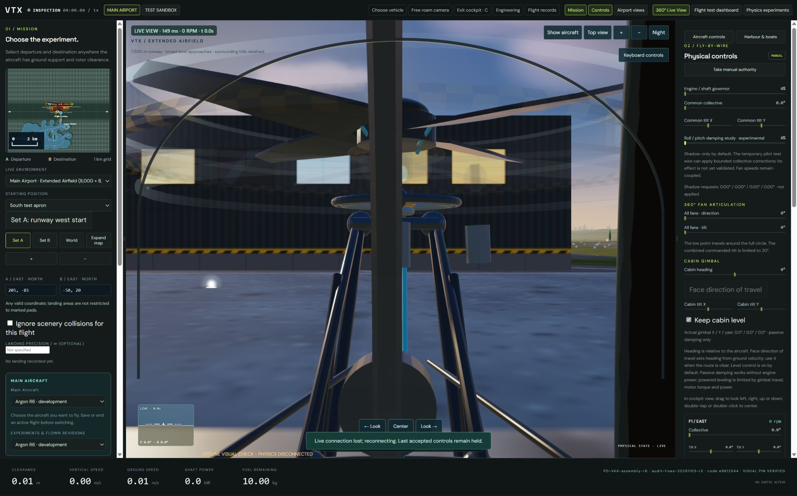
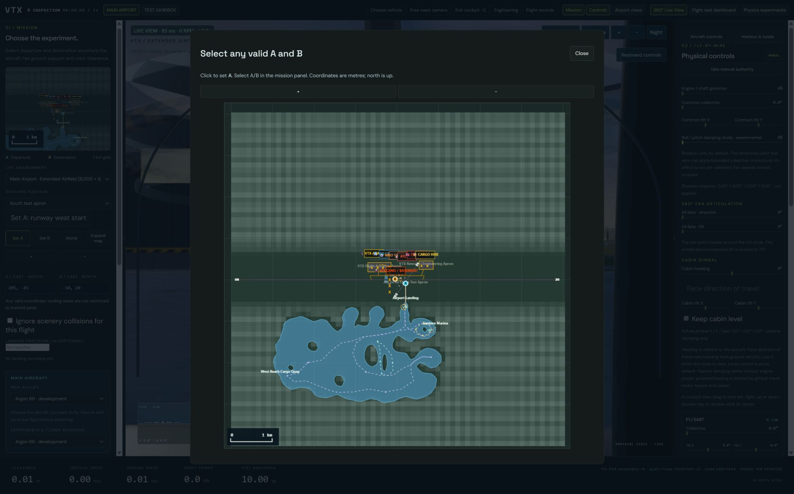

# Cockpit and navigation gallery

Development visuals captured in an isolated, frozen UI fixture. The fixture could not send controls to the live game. These are cockpit presentation checks, not flight acceptance evidence. Click any image or its link for full size.

## Ricochet: single compact helm

[Open daytime cockpit](cockpit-gallery/ricochet-marina-forward.jpg)

[Open night lighting](cockpit-gallery/ricochet-marina-night.jpg)

## Phantom flight deck

[Open cockpit](cockpit-gallery/phantom-forward-sharp.jpg) · [Left view](cockpit-gallery/phantom-left.jpg) · [Right view](cockpit-gallery/phantom-right.jpg)

## Argon cutaway

[Open fixed-seat view](cockpit-gallery/argon-cutaway.jpg)

## Navigation map

[Open map and scale](cockpit-gallery/map-scale-zoom.jpg)

