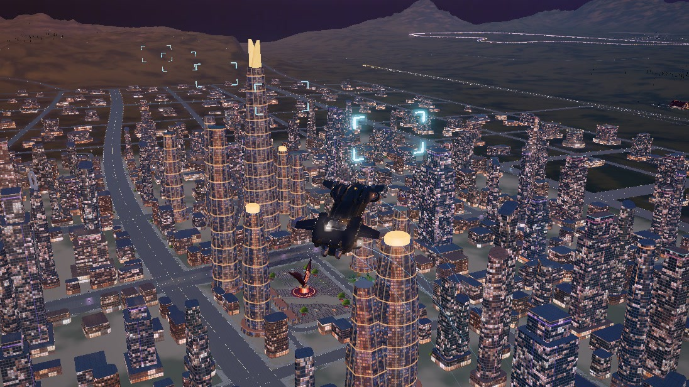

# Vaderland 32 field report

**20 November 2026 · Main Airport, Meridian and Lantern Sound**

Vaderland 32 connects Meridian Arrivals to Lantern Marina with a 1.28 km graded road, a signed fork, drop-off bays and a turnaround. A foot stair and gangway connect the road to the berths. The existing eight-gate Islet Trial starts on the water. [Vaderland 32 source snapshot](https://github.com/SDarkVader/-vtx-flight-sim/tree/codex/vaderland-v32)

## Manual Phantom A10-D flight

The pinned Phantom A10-D lifted vertically from the west threshold of Runway 08 and reached **1,698 m** above the world datum. The pilot flew towards Meridian using the normal controls with scenery collisions enabled.

On the northwest approach, about **940 m** from the Crest, groundspeed slowed to **4.6 m/s** while the aircraft climbed at **3.1 m/s** at about **494 m** elevation. Its nose began rising while pitch demand was steady at **0.8°** nose-up. Recorded pitch reached **37.6°** as the climb reversed. Later corrections reached the control limits. The right canard struck terrain at **370.13 s** of simulated time.

That sortie verified runway departure, the airborne approach and physical contact with the terrain. Sustained hover and controlled landing remain separate tests. The original flight telemetry, pilot input stream, and crash recorder stay on the test PC.

## Road and water checks

| Check | Recorded result |
| --- | --- |
| Lantern Shore Link | Pinned A10-D completed the outbound drive and turnaround in **121.5 s**, and the return in **94.2 s**, with zero collisions. |
| Survey | Road width **14 m**, maximum surveyed grade **8.57%**. The build matched **46,366** retained road-height probes and **14,065** wet-terrain probes. |
| Islet Trial | A stock Ricochet cleared all eight gates in **167.361 s** with zero fouls. Mid-lap checkpoint restore reproduced the boat state. |

## Frame rate and simulation rate

The flown desktop view was 50 ms per draw at best. During a live sample with **1×** selected, the solver advanced about **0.66 seconds per second of wall time**. Browser drawing, telemetry age and simulation time are measured separately.

A follow-up browser test used the same terrain, recorded A10-D telemetry and High settings at **1,096 × 862** on a GeForce RTX 4070 Ti SUPER. Each sample covers five seconds of WebGL draw intervals.

| View | Flown build | Frame-pacing candidate |
| --- | ---: | ---: |
| Runway 08 chase | 18.4 FPS | 60.0 FPS |
| Meridian approach | 18.3 FPS | 60.1 FPS |
| Crest district | 18.5 FPS | 60.0 FPS |

The candidate’s 95th-percentile draw interval was **18.5–18.7 ms**. It uses the same recorded poses and telemetry cadence and labels data age separately. A full manual run with the candidate and sustained **1×** solver throughput remain open. [Draft frame-pacing PR](https://github.com/SDarkVader/-vtx-flight-sim/pull/67)

## Verification scope

The filed v32 checks include **87 JavaScript** and **19 focused Python** passes. Six older A10-C identity and checkpoint tests failed in the broader local run. The browser candidate passed **89 JavaScript** checks. The published report covers the tested vehicles and routes. Flight handling and course results remain conditional on the machine and pilot.

[Return to Vaderland](../README.md) · [Gameplay media](VADERLAND_MEDIA.md)
