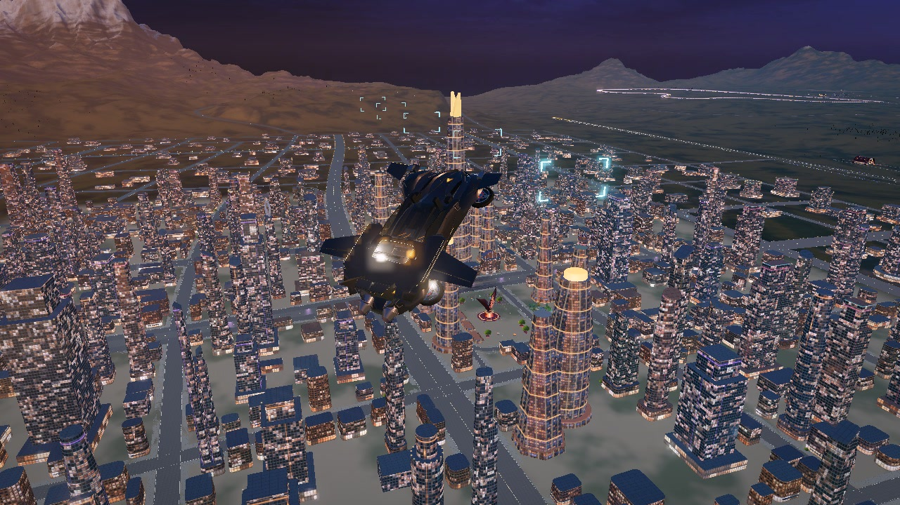
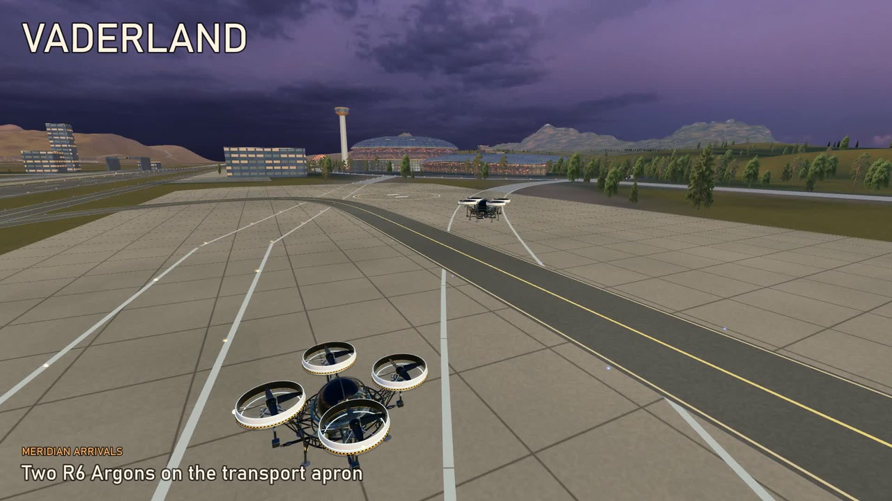
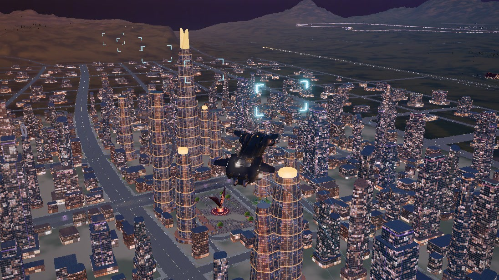
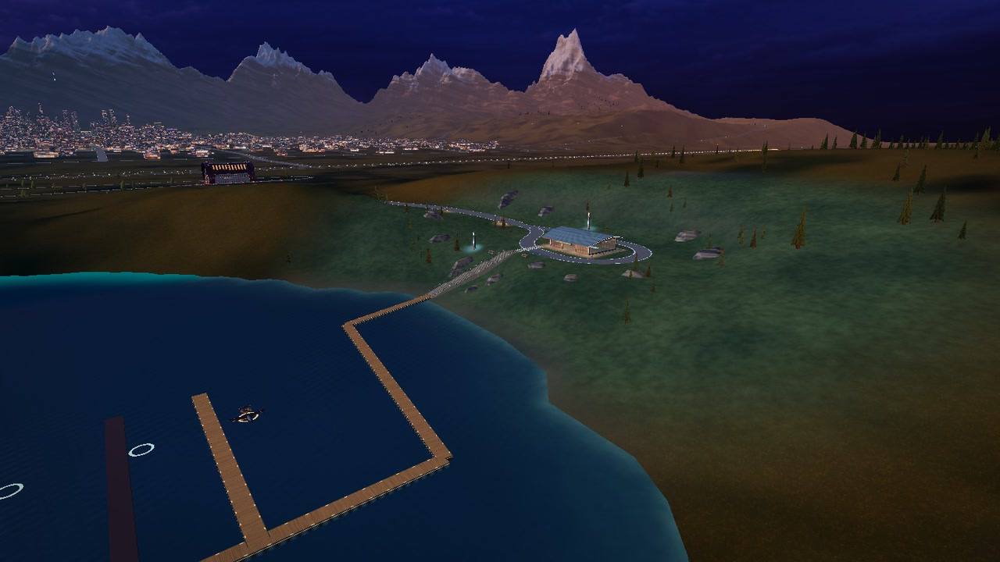
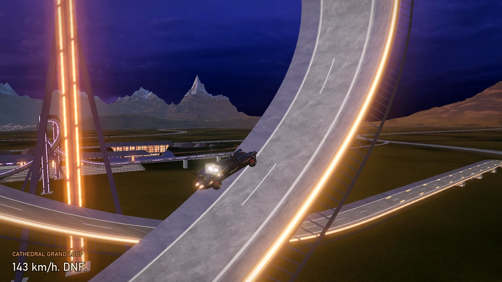

# Vaderland media

## Phantom A10-D · Manual flight

[Watch or download the A10-D flight reel](readme-images/vaderland/a10d-manual-flight-v32.mp4?raw=true) · 49 seconds · Vaderland 32 · 720p

The pilot lifts off vertically from Runway 08, climbs to 1,698 m above the world datum and approaches Meridian from the northwest. The hover attempt gives way to pitch oscillations, a descent and a terrain strike. The final frame shows the recorded contact at 370.13 s of simulated time.

The reel cuts between sections of the same retained manual flight in its original terrain, with the pinned A10-D model and recorded poses at their original coordinates. The camera, dusk lighting, VTX score and brief hold at impact are editorial. [Read the field report](VADERLAND_32_VERIFICATION.md).

## World showcase

[Watch or download the 96-second showcase](readme-images/vaderland/vaderland-showcase.mp4?raw=true) · Vaderland 30 · 720p · original VTX soundtrack

The trailer follows Argons at the transport apron, Phantoms over Meridian, both city air trials and Ricochets at Lantern Marina. It also keeps the hangar strike, spin, runway contact and both Grand Loop DNFs.

The scenes use rendered records of simulation runs. Some archive trajectories were placed into Vaderland for the edit. Camera angles, cuts and holds are editorial. Vehicle movement and outcomes come from the source runs.

## Recent captures

**Meridian approach · Vaderland 32.** Captured with the retained A10-D flight poses. [Read the field report](VADERLAND_32_VERIFICATION.md).

**Lantern Shore Link · Vaderland 32.** The new road reaches the marina turnaround. The stair and gangway meet the berth approach.

**Cathedral Grand Loop · Vaderland 30.** A retained stock Phantom attempt from the showcase.

[Return to Vaderland](../README.md)
