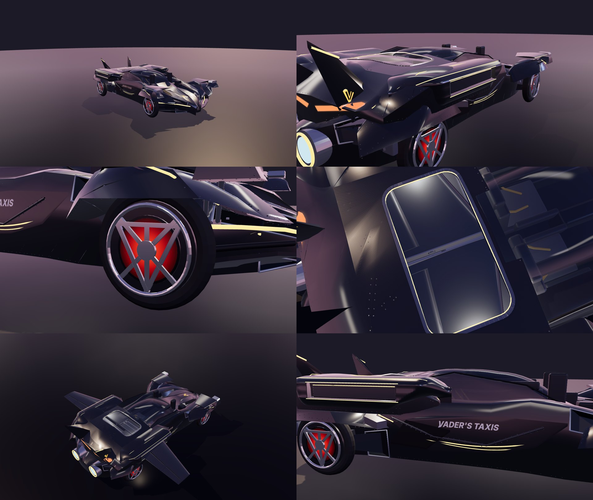

# Phantom A10 — visual pass (render only)



**What this is:** a render-only refinement of the A10 CAD export. Physics, the mass ledger, colliders, joint
definitions and `provenance.render_asset` are unchanged. The browser loads the refined sibling GLB instead of
the raw export; `?cad=1` loads the raw CAD GLB.

| File | Role |
|---|---|
| `tools/phantom/refine_phantom_visual.py` | shell smoothing, finishes, wing-bay window, wing-cassette cowls, alloy wheels |
| `tools/phantom/phantom_livery.py` | Vader's Taxis artwork, door swoops, LED lamps, rivets (called by the script above) |
| `public/assets/phantom-a10-visual.glb` | live sim asset (from `public/assets/phantom-a10.glb`) |
| `assets/derived/phantom-a10-cassette-visual.glb` | animated preview (from the cassette GLB; all 28 animations kept) |

Regenerate after any CAD re-export:

```
python tools/phantom/refine_phantom_visual.py public/assets/phantom-a10.glb public/assets/phantom-a10-visual.glb
python tools/phantom/refine_phantom_visual.py assets/derived/phantom-a10-cassette.glb assets/derived/phantom-a10-cassette-visual.glb
```

Needs `numpy pygltflib trimesh scipy pillow`. No Blender required.

## What changes

- **Smooth shell.** Crease-aware Phong tessellation of the exterior shell. Every original CAD vertex stays
  exactly where it was; only the new in-between vertices are lifted onto the smooth surface, at most 35 mm.
  Edges with a dihedral angle above 58° stay sharp.
- **Wing-cassette cowls.** One continuous body-side profile. It starts tangent to the roof, rolls over a
  shoulder into a near-vertical reveal panel that carries the wing slot, then tucks into the fender. Each end
  blends back into the haunch with a swept leading edge. The slot stays open, with a short tunnel back to the
  real mouth flange so the wing still deploys through it.
- **Wing-bay window.** A compact rounded window (about 0.58 × 1.12 m) is cut into the deck over both ball screws.
  The deck faces are clipped exactly to the window outline. The bay lid underneath is removed and the sleeve top
  plate is rendered as glazing. The window has a low-crown translucent panel, a slim Ti frame, an amber LED edge
  and two service lights. The lights are switched off on the `low` (phone) quality tier.
- **Finishes.** Clearcoat gunmetal and carbon, gold-amber light lines (emissive), smoked canopy, brushed Ti.
- **Livery.** Original angular V emblem: flat on each fin's outboard plane, ray-projected onto the bonnet.
  A slanted VADER'S TAXIS wordmark sits at the top of each door. Two curved amber swoops are ray-projected point
  by point onto each door and kept below the door's Z-line so they never cross a body line. The car also has a red
  LED tail chevron, white LED headlight blades, and about 4,400 dark dome rivets along the panel creases.
- **Wheels.** Forged-alloy faces with a V-T-X monogram spoke pattern (T crossbar, V arms, centre stem,
  X diagonals) and a centre cap. The lip ring is polished alloy instead of amber, and a mild red ember glow sits
  behind the spokes.

Every added node carries the extras `visual_only: true` and `mass_kg: 0`. The original node order, names, poses
and extras are preserved, so `phantom-look.js` drives the same joints.

## Known limits

- Below the front of each cowl, the original CAD haunch nose still shows as a small sharp edge. Removing it needs
  a hull edit in the CAD source (`build_a10_cassette.py`), not a render pass.
- With the wings stowed, the window mostly shows the stowed wing panels, which fill the panel level. The screws and
  rails show fully once the wings deploy.
- The size of `phantom-a10-visual.glb` is about 9.7 MB, against 2.8 MB for the raw export. The rivets and
  tessellation account for most of the increase.
