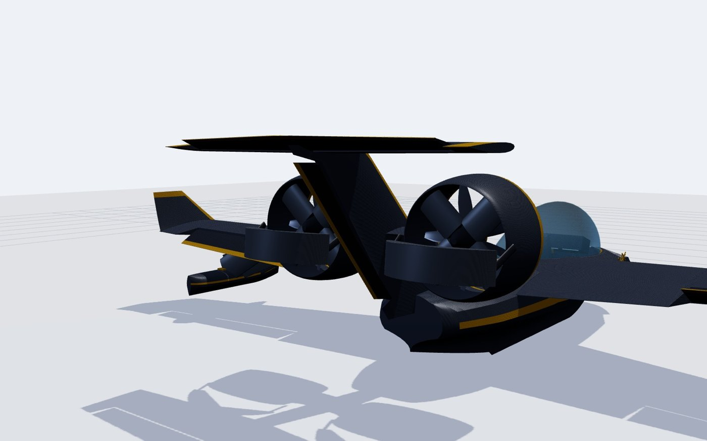
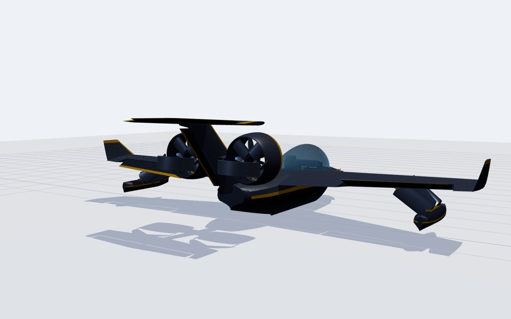

# Ricochet controls and actuators

Source: `src/vtx/ricochet/plant.py` (`RICOCHET_SURFACE_LIMITS`, `ARTICULATED_CHILD_SPECS`, `set_command`, `_slew_targets`, `_apply_actuator_controls`, `control_surface_telemetry`), `src/vtx/harbour_fleet.py` (`action`) and `public/vtx-env/harbour.js` (helm panel).

## Control channels

A command sets any subset of six channels. Each channel moves toward its commanded value no faster than its slew rate.

| Channel | Range | Unit | Slew rate | Drives |
| --- | --- | --- | --- | --- |
| `throttle` | 0..1 | fraction | 2.5 /s | Both fan speed governors |
| `differential_thrust` | −1..1 | fraction | 4.0 /s | Split between the fans |
| `rudder_deg` | −30..30 | degrees | 120 °/s | Rudder servo |
| `elevator_deg` | −20..20 | degrees | 100 °/s | Elevator servo |
| `aileron_deg` | −25..25 | degrees | 120 °/s | Both aileron servos, opposite senses |
| `reverse_bucket` | 0..1 | fraction of 85° | 2.2 /s | Both reverse-bucket servos |

There are three stages: the **command** (what was accepted), the **target** (the slewed set-point) and the **achieved** joint angle (what MuJoCo reached). The physics uses only achieved angles and rotor speeds.

- The standalone plant clips out-of-range values into range (`set_command`).
- The harbour fleet rejects them instead, with "Invalid harbour control …", and also rejects unknown channel names (`HarbourFleet.action`).
- While a boat is moored, any throttle above 0.02 is refused: "Release the berth before applying propulsion".

## Sign conventions

| Channel | Positive means | Physical effect |
| --- | --- | --- |
| `rudder_deg` | Trailing edge to port | Side force to starboard at the tail, nose yaws to port (left) |
| `elevator_deg` | Trailing edge up | Tail down force, nose pitches up |
| `aileron_deg` | Roll right | Port aileron trailing edge down, starboard trailing edge up |
| `differential_thrust` | More starboard thrust | Nose yaws to port (left); see [open questions](README.md#open-questions) |
| `reverse_bucket` | Bucket deployed | Jet deflected forward and slightly up |

## Actuators

Eight MuJoCo actuators drive hinge joints on separate bodies. The surfaces are position servos with gain kp and velocity damping kv. The fans are torque motors.

| Actuator | Joint | Type | kp | kv | Force or torque limit | Joint damping | Armature |
| --- | --- | --- | ---: | ---: | --- | ---: | ---: |
| `aileron_port_servo` | `aileron_port_hinge` | Position servo | 360 | 18 | ±260 N·m | 1.2 | 0.05 |
| `aileron_stbd_servo` | `aileron_stbd_hinge` | Position servo | 360 | 18 | ±260 N·m | 1.2 | 0.05 |
| `elevator_servo` | `elevator_hinge` | Position servo | 400 | 20 | ±300 N·m | 1.4 | 0.06 |
| `rudder_servo` | `rudder_hinge` | Position servo | 400 | 20 | ±300 N·m | 1.4 | 0.06 |
| `reverse_bucket_port_servo` | `reverse_bucket_port_hinge` | Position servo | 440 | 22 | ±360 N·m | 1.8 | 0.08 |
| `reverse_bucket_stbd_servo` | `reverse_bucket_stbd_hinge` | Position servo | 440 | 22 | ±360 N·m | 1.8 | 0.08 |
| `fan_motor_port` | `fan_rotor_port_hinge` | Torque motor | n/a | n/a | ±200 N·m (command range ±220) | 0.02 | 0.02 |
| `fan_motor_stbd` | `fan_rotor_stbd_hinge` | Torque motor | n/a | n/a | ±200 N·m (command range ±220) | 0.02 | 0.02 |

Hinge points, axes and ranges are in [Geometry](GEOMETRY.md#hinge-points-and-axes). Aerodynamic hinge moments act on the surface joints, clipped at ±45 N·m (ailerons) and ±55 N·m (elevator and rudder). So a servo can lag or saturate at high dynamic pressure. A servo counts as saturated when its force reaches 98% of its limit, and the plant then raises `SERVO_SATURATED`.

The fan governor and power limit are described in [Propulsion and energy](PROPULSION_AND_ENERGY.md).

## Behaviour without energy

When the fuel reserve reaches zero (`fuel ≤ 1e-4 kg`, flag `FUEL_EXHAUSTED`):

- each servo's set-point is replaced by its current angle, so the surfaces stop holding commanded positions and drift with their loads;
- both fan motors get zero torque and spin down against blade drag.

## Telemetry: commanded, target and achieved

`control_surface_telemetry()` reports, for the rudder, elevator, aileron pair and reverse-bucket pair:

- the commanded value, the target and the achieved value, plus port and starboard values for the pairs;
- the rate, the limits, and a `saturated` flag.

The aileron value reported is the mean of the starboard and negated port deflections. The helm display and `boats[].command` in the public fleet status show the **accepted command**, not the achieved deflection. During actuator travel the two differ. A rudder at 120 °/s, for example, takes 0.25 s to go from 0 to 30°.

## Helm panel (harbour)

The harbour panel in `public/vtx-env/harbour.js`:

| Control | Range and step |
| --- | --- |
| Throttle slider | 0–100%, step 1% |
| Rudder slider | −30° to +30°, step 0.5° |
| Reverse bucket slider | 0–100%, step 5% |
| Cut throttle button | Sends `throttle: 0` immediately |
| Differential thrust (advanced) | −100% to +100%, step 2% |
| Elevator (advanced) | −20° to +20°, step 0.5° |
| Ailerons (advanced) | −25° to +25°, step 0.5° |

The panel also offers boat selection, release, mooring at a berth, restart at the home berth or at a chosen position, and race and time-trial staging. Cockpit camera and display details are in [Vehicle controls, 17 November](../VEHICLE_CONTROLS_20261117.md).

## HTTP interface (harbour)

| Request | Purpose |
| --- | --- |
| `GET /api/harbour` | Fleet status (see [Harbour operations](HARBOUR_OPERATIONS.md#telemetry)) |
| `GET /api/harbour/world` | Harbour world description |
| `GET /api/harbour/model?boatId=…` | Visual geometry for one boat |
| `POST /api/harbour/action` | `{"action": "select", "boatId": …}` |
| | `{"action": "command", "boatId": …, "command": {"throttle": 0.4, "rudder_deg": 6}}` |
| | `{"action": "dock", "boatId": …, "berthId": …}` |
| | `{"action": "undock", "boatId": …}` |
| | `{"action": "restart", "boatId": …}`, optionally with `"position": [x, y]`, `"timeTrial": true` or `"raceId": "…"` |

The `airport=true` query parameter addresses the Airport harbour.

## Text command parser

`src/vtx/ricochet/live.py` contains a parser that turns free text and loose JSON into the six channels. On this branch nothing else imports it, and the harbour accepts only exact channel names.

- **Channel aliases:**
  - throttle: power, thrust, engine
  - rudder: helm, yaw
  - elevator: pitch, stab
  - ailerons: roll, bank
  - reverse bucket: reverser, bucket
- **Magnitude words:** full, max or hard = 1.0; high = 0.85; three-quarter or cruise = 0.75; half = 0.5; quarter, gentle or slight = 0.25; touch = 0.2; idle = 0.08; zero, stop, cut, stow or neutral = 0.
- **Direction words:**
  - rudder: port or left = +1, starboard or right = −1
  - elevator: up, climb or pull = +1, down, dive or push = −1
  - ailerons and differential thrust: right or starboard = +1, left or port = −1
