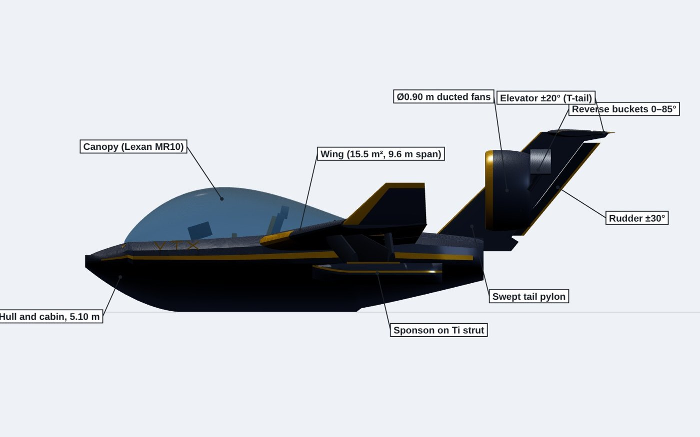
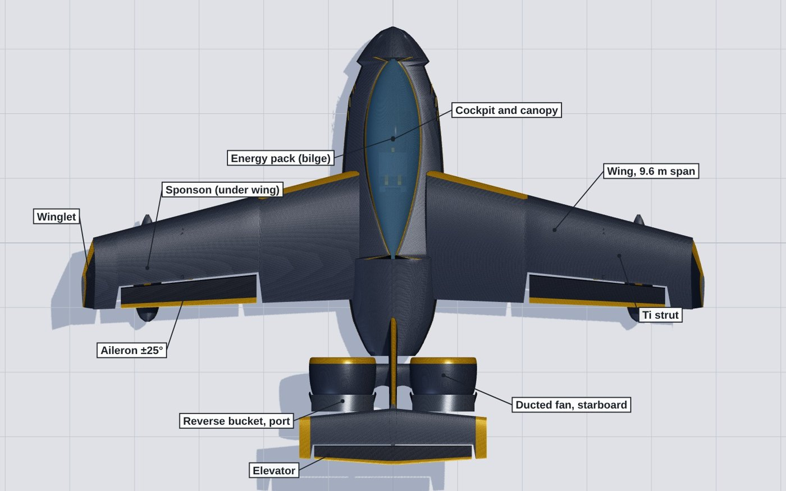
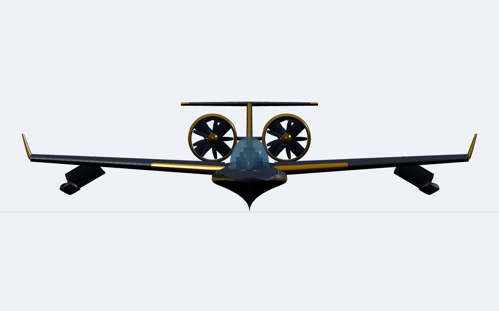

# Ricochet geometry and dimensions

All positions are in the VTX body frame (+X forward, +Y port, +Z up, origin at the hull keel datum), in metres. Part envelopes were measured from the pinned Concept A model `public/assets/ricochet-concept-a.glb` with each node's own offset applied. Hinge points and axes come from `src/vtx/ricochet/concept_a_builder.py`.

## Overall envelope (Concept A)

| Dimension | Measured | Design value (`spec_math.py`) |
| --- | --- | --- |
| Length, bow (x 3.350) to elevator trailing edge (x −3.434) | 6.784 | 6.80 |
| Span over winglet tips (y ±4.820) | 9.640 | 9.60 (wing) |
| Height, keel (z 0) to top of T-tail pylon (z 2.342) | 2.342 | 2.35 |
| Hull beam | 1.600 | 1.60 |
| Sponson stance, centre to centre | 7.600 | 7.60 |
| Cockpit length | n/a | 3.30 |
| Tail pylon height | n/a | 1.60 |
| Duct diameter | 0.90 nominal (1.04 outer shroud) | 0.90 |

## Parts

| Part (GLB node) | x min..max | y min..max | z min..max | Moves? |
| --- | --- | --- | --- | --- |
| Hull and cabin | −1.750..3.350 | −0.800..0.800 | 0.000..1.101 | Fixed |
| Canopy glass | −0.250..2.850 | −0.420..0.420 | 0.885..1.604 | Fixed |
| Cockpit interior | 0.735..2.041 | −0.280..0.280 | 0.718..1.368 | Fixed |
| Avionics display | 1.727..1.783 | −0.240..0.240 | 0.976..1.114 | Fixed |
| Wing, port | −1.031..1.150 | 0.520..4.640 | 0.769..1.233 | Fixed |
| Wing, starboard | −1.031..1.150 | −4.640..−0.520 | 0.769..1.233 | Fixed |
| Winglet, port | −1.020..0.080 | 4.556..4.820 | 1.120..1.660 | Fixed |
| Winglet, starboard | −1.020..0.080 | −4.820..−4.556 | 1.120..1.660 | Fixed |
| Aileron, port | −1.014..−0.488 | 2.110..4.210 | 0.935..1.167 | Hinged |
| Aileron, starboard | −1.014..−0.488 | −4.210..−2.110 | 0.935..1.167 | Hinged |
| Sponson strut, port | −0.680..0.271 | 3.049..3.906 | 0.444..1.183 | Fixed |
| Sponson strut, starboard | −0.680..0.271 | −3.906..−3.049 | 0.444..1.183 | Fixed |
| Sponson, port | −1.220..0.440 | 3.581..4.019 | 0.360..0.628 | Vertical flex |
| Sponson, starboard | −1.220..0.440 | −4.019..−3.581 | 0.360..0.628 | Vertical flex |
| Tail pylon and T-tail | −3.365..−0.920 | −1.450..1.450 | 0.780..2.342 | Fixed |
| Elevator | −3.434..−3.136 | −1.220..1.220 | 2.264..2.326 | Hinged |
| Rudder | −3.249..−2.087 | −0.027..0.027 | 0.980..2.170 | Hinged |
| Duct, port | −2.350..−1.770 | 0.260..1.300 | 1.040..2.080 | Fixed |
| Duct, starboard | −2.350..−1.770 | −1.300..−0.260 | 1.040..2.080 | Fixed |
| Fan rotor, port | −2.100..−2.020 | 0.357..1.219 | 1.122..1.996 | Spins |
| Fan rotor, starboard | −2.100..−2.020 | −1.203..−0.341 | 1.122..1.996 | Spins |
| Fan spinner, port | −2.025..−1.855 | 0.668..0.892 | 1.448..1.672 | Spins |
| Fan spinner, starboard | −2.025..−1.855 | −0.892..−0.668 | 1.448..1.672 | Spins |
| Reverse bucket, port | −2.610..−2.303 | 0.257..1.303 | 1.543..2.087 | Hinged |
| Reverse bucket, starboard | −2.610..−2.303 | −1.303..−0.257 | 1.543..2.087 | Hinged |

Moving parts are shown in their neutral position: surfaces at 0°, buckets stowed, sponsons at rest.

## Hinge points and axes

| Joint | Hinge point | Axis | Range | Positive motion |
| --- | --- | --- | --- | --- |
| `aileron_port_hinge` | (−0.586, 3.170, 1.039) | (−0.098, 0.993, 0.062) | ±25° | Port trailing edge up |
| `aileron_stbd_hinge` | (−0.586, −3.170, 1.039) | (0.098, 0.993, −0.062) | ±25° | Starboard trailing edge up |
| `elevator_hinge` | (−3.140, 0.000, 2.302) | (0, 1, 0) | ±20° | Trailing edge up (nose up) |
| `rudder_hinge` | (−2.590, 0.000, 1.580) | (0.604, 0, −0.797) | ±30° | Trailing edge to port (yaw left) |
| `reverse_bucket_port_hinge` | (−2.330, 0.780, 1.560) | (0, −1, 0) | 0..85° | Bucket swings down across the jet |
| `reverse_bucket_stbd_hinge` | (−2.330, −0.780, 1.560) | (0, −1, 0) | 0..85° | Bucket swings down across the jet |
| `fan_rotor_port_hinge` | (−2.050, 0.780, 1.560) | (1, 0, 0) | Unlimited | Rotor spin |
| `fan_rotor_stbd_hinge` | (−2.050, −0.780, 1.560) | (−1, 0, 0) | Unlimited | Counter-rotating spin |
| `sponson_port_flex_z` | (−0.340, 3.800, 0.480) | (0, 0, 1), slide | ±0.06 m | Sponson rises |
| `sponson_stbd_flex_z` | (−0.340, −3.800, 0.480) | (0, 0, 1), slide | ±0.06 m | Sponson rises |

The rudder hinge is inclined along the swept pylon, so its axis has a forward component. In the F03 variant the sponson mounts sit at z 0.42 instead of 0.48.

## Hydrodynamic meshes

The water forces are integrated over closed triangle meshes, one per body. The same meshes are the MuJoCo collision meshes, and `verify_pinned_geometry` checks that they match.

| Mesh | Concept A | F03 baseline |
| --- | --- | --- |
| Main hull, source | GLB node `Ricochet_ConceptA_Hull_Cabin` | `RC01_F03_cad_stations.npz` station loft |
| Main hull, vertices / faces | 3,138 / 6,224 | 48 / 92 |
| Main hull, extent (x × y × z) | 5.100 × 1.600 × 1.101 | 5.050 × 1.600 × 1.275 |
| Main hull, gross volume | 2.963 m³ | 4.808 m³ |
| Sponson, source | GLB nodes `Ricochet_Sponson_Port/Stbd` | Parametric chined float `F03_SPN_P/S` |
| Sponson, vertices / faces (each) | 642 / 1,280 | 222 / 440 |
| Sponson, extent (each) | 1.660 × 0.438 × 0.268 | 1.120 × 0.360 × 0.280 |
| Sponson, gross volume (each) | 0.102 m³ | 0.057 m³ |
| Total enclosed volume | 3.167 m³ | 4.922 m³ |
| Design minimum watertight volume | 1.80 m³ | 1.80 m³ |

The Concept A sponson mount is set so that the sponson bottom sits at z 0.36, which puts 0.20 m of sponson under water at the 0.56 m calm design draft (`hull_geometry.py`).

## Colours and materials (visual)

From `concept_a_builder.py`: satin carbon charcoal body, dark matte cockpit tub, VTX Racing Gold accents, brushed Ti-6Al-4V struts, anodised fan blades, smoke-blue tinted Lexan MR10 canopy, Alcantara seat and cyan-blue display glow. These are render properties only and have no effect on the physics.
