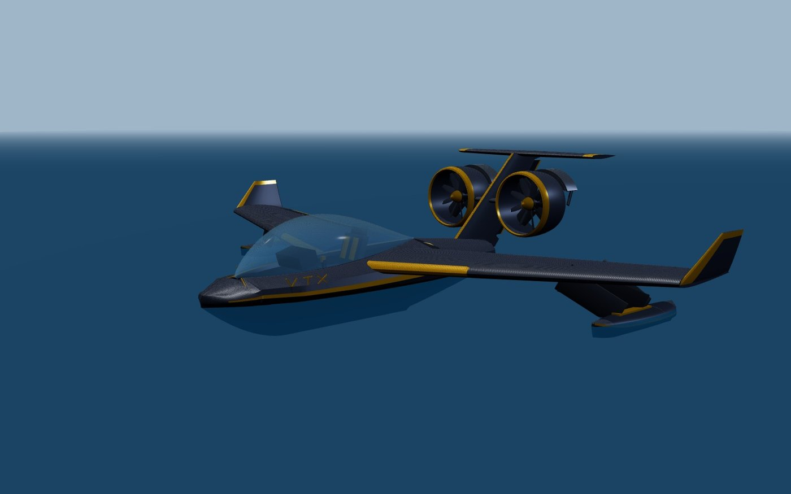
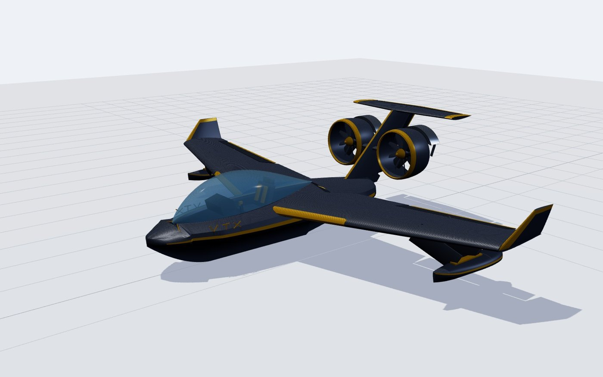
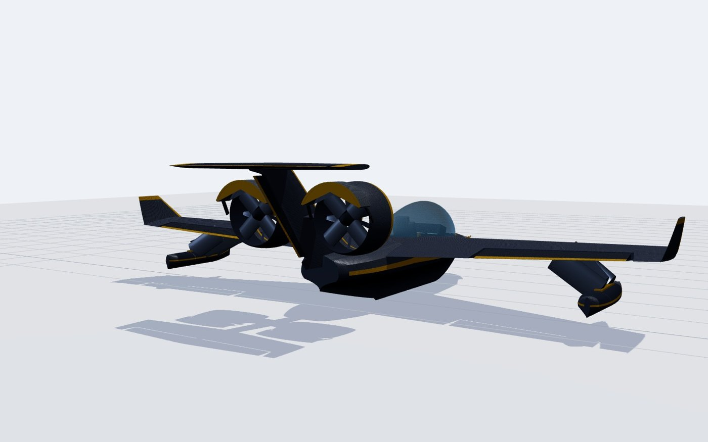

# Ricochet RC-01 technical documentation

The Ricochet RC-01 is VTX's amphibious water craft: a single-seat planing hull with a canopy, a 9.6 m wing with winglets, two outboard sponsons on titanium struts, a T-tail on a swept pylon and two Ø0.90 m ducted fans driven by electric motors. In VTX it runs as a MuJoCo rigid-body plant coupled to the water solver. Two Ricochets operate in the Airport harbour of the Vaderland worlds.

| | |
| --- | --- |
|  |  |
| Three-quarter front | Three-quarter rear: T-tail, ducted fans and reverse buckets |

The renders are of the pinned Concept A model, `public/assets/ricochet-concept-a.glb`, the same geometry the physics uses.

Every figure in these documents is read from the code, the model data or the built MuJoCo model on branch `codex/vaderland-v33-harbour-throughput-20261121`. Values the source marks as provisional are marked that way here too. Measured dimensions come from the pinned Concept A GLB and the F03 station file.

## Documents

| Document | Covers |
| --- | --- |
| [Geometry and dimensions](GEOMETRY.md) | Overall size, every named part, hull and sponson meshes, hinge points and axes |
| [Mass and structure](MASS_AND_STRUCTURE.md) | Mass register, load cases, centre of gravity, inertia, buoyancy reserve, structural rigidity, sponson suspension, flooding |
| [Controls and actuators](CONTROLS_AND_ACTUATORS.md) | The six control channels, limits and slew rates, servos and motors, sign conventions, helm panel, API and language commands |
| [Propulsion and energy](PROPULSION_AND_ENERGY.md) | Ducted fans, speed governor, thrust, reverse buckets, differential thrust, power, fuel and energy |
| [Hydrodynamics and aerodynamics](HYDRO_AND_AERO.md) | Every force the craft feels from water and air, with coefficients |
| [Harbour operations](HARBOUR_OPERATIONS.md) | The harbour fleet, solver cadence, mooring and docking, staging, flags, telemetry, performance |

## Key figures (Concept A, load case LC-01)

| Quantity | Value | Source |
| --- | --- | --- |
| Overall length | 6.78 m measured (6.80 m design) | GLB parts; `spec_math.RC01_OVERALL_LENGTH_M` |
| Span over winglets | 9.64 m measured (9.60 m design wing) | GLB parts; `RC01_WINGSPAN_M` |
| Height, keel datum to top of T-tail | 2.34 m measured (2.35 m design) | GLB parts; `RC01_OVERALL_HEIGHT_M` |
| Hull length × beam × depth | 5.10 × 1.60 × 1.10 m | Concept A hull mesh |
| Sponson centreline stance | 7.60 m (±3.80 m) | `SPONSON_CONCEPT_A_MOUNT_VTX_M` |
| Mass | 900.0 kg (85 kg passenger aboard) | Mass register `rc01-f03-lc-v2` |
| Centre of gravity | x 0.506, y 0.000, z 0.704 m | Mass register |
| Wing area | 15.50 m² | `RC01_WING_AREA_M2` |
| Design waterline draft | 0.56 m | `RC01_DESIGN_DRAFT_M` |
| Enclosed watertight volume | 3.167 m³ (reserve buoyancy 2,265 kg) | Hull and sponson meshes |
| Fans | 2 × Ø0.90 m, 1,450 N each at 5,202 rpm (2,900 N total) | `MAX_THRUST_PER_FAN_N` |
| Motor limits | 200 N·m and 68 kW per fan | `_apply_actuator_controls` |
| Control surfaces | 2 ailerons, elevator, rudder, 2 reverse buckets | `ARTICULATED_CHILD_SPECS` |

## Variants

| Airframe variant | Hull variant | Hull source | Used by |
| --- | --- | --- | --- |
| `ricochet-concept-a` | `concept_a` | Pinned GLB `public/assets/ricochet-concept-a.glb` (3,138-vertex hull) | Both harbour boats |
| `ricochet-rc01-f03` | `f03_baseline` | `experiments/ricochet/rc01_f03/model/RC01_F03_cad_stations.npz` (48-vertex loft) | Selectable in the harbour fleet; standalone lake runs |
| `ricochet-rc01-dev` | `f03_baseline` by default | Same as F03 | Standalone plant default |

Both harbour variants share the mass register, control surfaces, fans and aerodynamics. They differ in hull and sponson meshes, sponson mount height and strut spring, and canopy drag. See [Geometry](GEOMETRY.md) and [Hydrodynamics and aerodynamics](HYDRO_AND_AERO.md).

## Conventions

- **Body frame (VTX):** +X forward, +Y port, +Z up. The origin is the hull keel datum: the Concept A hull's lowest point is at z = 0.
- **Source frame (F03):** the F03 design data uses +Y starboard. `mass_register.polar_f03_to_vtx`, `axial_f03_to_vtx` and `inertia_f03_to_vtx` convert it.
- **Units:** SI throughout. Angles in the API are degrees, and joint states in MuJoCo are radians.
- **Water:** freshwater ρ = 999.1 kg/m³, ν = 1.139 × 10⁻⁶ m²/s; air ρ = 1.225 kg/m³; g = 9.80665 m/s² (`water/datum.py`).
- **Status tags:** mass items and hydrodynamic coefficients carry `derived_geometry`, `standard_empirical`, `envelope_nominal` or `provisional_unverified`. Treat provisional values as placeholders awaiting weighing, tank or CFD data.

## Where the code lives

| Concern | File |
| --- | --- |
| Rigid-body plant, actuators, aero, propulsion, flags, telemetry | `src/vtx/ricochet/plant.py` |
| Mass register and load cases | `src/vtx/ricochet/mass_register.py` |
| Hull and sponson meshes | `src/vtx/ricochet/hull_geometry.py` |
| Concept A GLB builder, hinge points, colours | `src/vtx/ricochet/concept_a_builder.py` |
| Design envelope, materials, rigidity, canopy drag | `src/vtx/ricochet/spec_math.py` |
| Language control parsing | `src/vtx/ricochet/live.py` |
| Mesh hydrodynamics | `src/vtx/water/hydrodynamics.py` |
| Water datum, constants, calibration profile | `src/vtx/water/datum.py` |
| Harbour fleet (100 Hz shared scene) | `src/vtx/harbour_fleet.py`, `src/vtx/harbour_session.py`, `src/vtx/harbour_water.py` |
| Helm panel and boat display | `public/vtx-env/harbour.js`, `public/boat-avionics.js` |

The cockpit camera and helm display are described in [Vehicle controls, 17 November](../VEHICLE_CONTROLS_20261117.md).

## Open questions

- **Differential thrust wording.** Positive `differential_thrust` puts more thrust on the starboard fan, which yaws the nose to port. The language parser maps "right" and "starboard" to +1 (`live._SIGNED_DIR_WORDS`). So "differential right" turns the craft left. Confirm the intended meaning before relying on spoken or typed differential commands.
- **Provisional mass items.** The hull shell (332 kg) and wing assembly (155 kg) are `provisional_unverified` (not weighed).
- **Provisional hydrodynamics.** The calibration profile `f03-provisional-v1` uses ITTC, strip-theory and Savitsky baselines, not tank or CFD data for this hull.
- **Propulsion subsystems.** Motor, gearbox, cooling, controllers and the thrust, torque and power map are listed as unverified in `PROPULSION_INSTALLATION_SPECS`.
