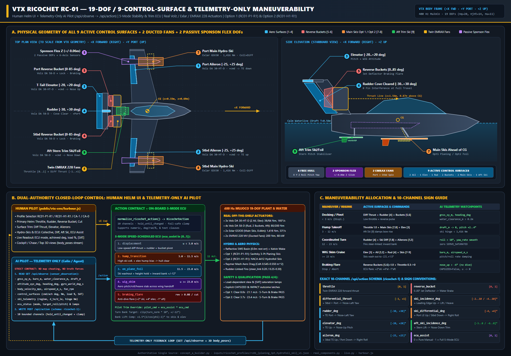
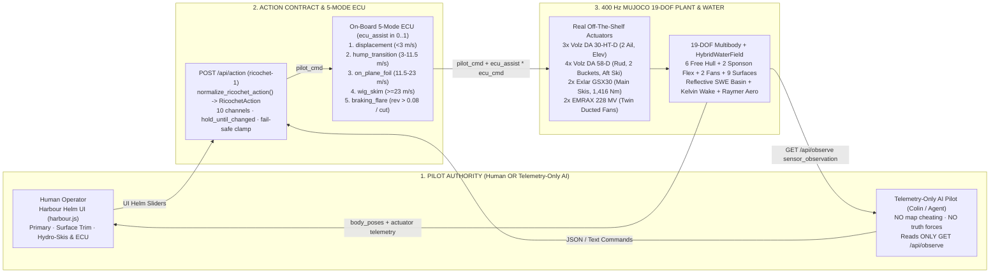

# Ricochet RC-01 — Consolidated 19-DOF / 9-Control-Surface Model & Telemetry Control Guide

One build command, one consolidated `.blend` + Blendstra articulated `.glb`, all 9 active control surfaces (19 DOFs), and all retained physics, actuator, ECU, and Blendstra updates — without touching legacy `public/assets/ricochet-concept-a.glb` (`SHA-256: 00f7d9cff2092fe433c9b66a0846774724de26486e92ba592736cd2ae1647124`).

---

## 1. One-Command Build (Zero Arguments)

Run **one command** from the repository root — no required flags, no multi-step flag soup, and no touching any open Blender GUI window:

```powershell
# Full build (works from plain system Python `py` or `.venv` — zero external deps needed in the outer Python):
# Exports authoritative 19-DOF / 9-surface MuJoCo rig & sweep, then auto-locates headless Blender 5.2+
# to build the consolidated .blend, .glb, and studio previews:
python docs/ricochet/complete_model/build_complete_model.py
```

Or invoke directly from headless Blender (auto-uses repo defaults and any existing matching `rig_spec.json` / `sweep.json` / `cockpit_study.json`):

```powershell
blender -b --factory-startup --python docs/ricochet/complete_model/build_complete_model.py
```

### Optional Overrides (All Auto-Defaulted When Omitted)

| Flag | Default | Purpose |
| :--- | :--- | :--- |
| `--profile` | `rc01-planing-3pt-v1` (`RC01-P1-R1`) | Primary 19-DOF / 9-surface build (also accepts `RC01-H1-R1` / `rc01-hydrofoil-ski-v1`) |
| `--alt-profile` | Companion 9-surface option (`rc01-hydrofoil-ski-v1`) | Alternate hydro-ski collection embedded inside the same `.blend` (pass `none` to omit) |
| `--out` | `scratch/complete_model` | Output folder for the consolidated `.blend`, `.glb`, report, and previews |
| `--skip-export` | off | Reuse existing matching `rig_spec.json` & `sweep.json` without re-running MuJoCo |
| `--no-render` | off | Skip rendering the 3 studio preview PNGs |
| `--no-cockpit-study` | off | Skip embedding the 10 cockpit-study enclosure collections |
| `--blender` | auto-detected (`PATH`, `BLENDER_EXE`, `Blender Foundation`) | Explicit Blender executable path |

---

## 2. One Consolidated Model & Retained Updates

Running the single command outputs **one** authoritative model set in `scratch/complete_model/`:

| Artifact | Contents |
| :--- | :--- |
| `scratch/complete_model/ricochet_rc01_complete.blend` | Complete interactive Blender 5.2+ rig: all 14 MuJoCo physical bodies & 9 active surfaces + 2 passive sponson flex slides + 2 counter-rotating fans, cleared rudder hinge cove, `RC01_Controls` with live drivers, real actuator mount markers, baked 24 fps MuJoCo sweep, toggleable Option 2 hydrofoil-ski collection (`Alt_rc01-hydrofoil-ski-v1`, also driven by `RC01_Controls`), all 10 cockpit-study enclosures (`Cockpit_Study_Options`, hidden by default), and embedded `README_RC01_COMPLETE_MODEL`. |
| `scratch/complete_model/ricochet_rc01_blendstra_articulated.glb` | Blendstra-ready articulated glTF 2.0 binary: all 14 verified physical body containers (`physical_body`, `blendstra_id`, `ricochet_joint`, `hinge_axis_vtx` / `slide_axis_vtx`, `range_deg` / `range_m`, `actuator_component` extras), unified 7 canonical PBR materials (`carbon_satin`, `vtx_gold_paint`, `titanium_strut`, `canopy_glass` `BLEND` alpha, `cockpit_detail`, `avionics_glow`, `fan_rotor`) with vertex colors (`COLOR_0`), 34° split normals, zero `.001` duplicates, and 13 baked animation tracks (all 9 active surfaces + 2 fans + 2 passive sponson Z slides). |
| `scratch/complete_model/rig_spec.json` & `sweep.json` | Authoritative 19-DOF / 9-surface MuJoCo hinge frames, command map, actuator envelopes, and 800-frame bench sweep (`0.000000 m` pos error, `0.056°` max rot error across 400 checked frames). |
| `scratch/complete_model/build_complete_model_report.json` | Machine-readable build verification manifest (`bodies: 14`, `control_surface_count: 9`, `cockpit_study_cases_loaded: 10`, pose parity & material checks). |

### All Updates Retained Between Concept A Baseline & Now
1. **19-DOF / 9-Control-Surface Real-Component Actuation:** Real off-the-shelf torque/speed envelopes from [`docs/ricochet/components/components.json`](../components/components.json) (Volz DA 30-HT-D, Volz DA 58-D, Exlar GSX30-0602, EMRAX 228 MV).
2. **Both Selectable High-Speed Ski Architectures Retained:**
   - **`RC01-P1-R1` (`rc01-planing-3pt-v1`)** — Option 1: 3-point Savitsky planing skis + aft stern trim ski (primary articulated rig in the `.blend`; selectable live in simulator & Harbour UI).
   - **`RC01-H1-R1` (`rc01-hydrofoil-ski-v1`)** — Option 2: Cambered NACA 4412 hydrofoil-section skis + aft hydrofoil-ski (embedded & articulated in `Alt_rc01-hydrofoil-ski-v1` inside the same `.blend`; selectable live in simulator & Harbour UI).
   - **`RC01-CA-1` (`rc01-real-components-v1`)** & **`RC01-CA-0` (`profile=None`)** — Baseline real-component skis and bit-identical legacy Concept A preserved selectable in the simulator.
3. **SWE Reflective Basin Boundaries (`src/vtx/water/shallow_water.py`):** Eliminated the wet-wall water-drop and rest-energy-gain defect (`0.0 m` lake-at-rest error; `1.42e-16` solitary pulse relative mass error).
4. **Cleared Rudder Hinge Cove (`rudder_cove_clear=True`):** `0` vertices interfering with the tail fin at `-30°`, `0°`, and `+30°` (all other surfaces also verified `0` interference).
5. **5-Mode On-Board Stability & Trim ECU (`src/vtx/ricochet/real_components.py`):** `displacement`, `hump_transition`, `on_plane_foil`, `wig_skim`, and `braking_flare` with coordinated inward turn banking, bank lift compensation, anti-dive flare, and additive pilot override (`ecu_assist ∈ [0, 1]`).
6. **Blendstra Material, Vertex-Color & Sponson-Flex Fixes:** Unified 7 canonical PBR materials with `ShaderNodeVertexColor('Color')`, zero `.001` material duplicates, `canopy_glass` `BLEND` alpha (`0.36`), 34° split normals on procedural meshes, `sponson_port_flex_m` / `sponson_stbd_flex_m` slide Z drivers, and mechanical-stop hard bounds on `RC01_Controls` so dynamic MuJoCo overshoots aren't clipped.
7. **Quantitative Qualification Evidence Retained:** `scratch/complete_model/option1_vs_option2_comparison.json` and `scratch/complete_model/closed_loop_maneuver_report.json` (4/4 closed-loop telemetry-only maneuvers passing on both `RC01-P1-R1` and `RC01-H1-R1`).

---

## 3. Control Surfaces & Telemetry-Only AI Maneuverability Diagram



*High-resolution vector source: [`ricochet_control_surfaces_diagram.svg`](ricochet_control_surfaces_diagram.svg) — regenerated (both `.svg` and `.png`) directly from `concept_a_builder.py` and `inputs/ricochet_profiles/*.json` via `python docs/ricochet/complete_model/generate_control_surfaces_diagram.py` (works from plain stdlib Python).*

### Dual-Authority Closed-Loop Control Architecture (Human & Telemetry-Only AI)



---

## 4. Complete 19-DOF / 9-Control-Surface & 10-Channel Reference

### All 9 Active Control Surfaces (+ 2 Fans + 2 Passive Sponson Flex + 6-DOF Hull = 19 DOFs)

| # | Surface / Body | MuJoCo Joint | Actuator Part | Mechanical Range | Command Channel (`+` Effect) |
|---|---|---|---|---|---|
| 1 | Port Aileron (`aileron_port`) | `aileron_port_hinge` | Volz DA 30-HT-D (`36/64 N·m`, `165°/s`) | `[-25°, +25°]` | `aileron_deg` (`+` → port TE down, right roll) |
| 2 | Stbd Aileron (`aileron_stbd`) | `aileron_stbd_hinge` | Volz DA 30-HT-D (`36/64 N·m`, `165°/s`) | `[-25°, +25°]` | `aileron_deg` (`+` → stbd TE up, right roll) |
| 3 | T-Tail Elevator (`elevator`) | `elevator_hinge` | Volz DA 30-HT-D (`36/64 N·m`, `165°/s`) | `[-20°, +20°]` | `elevator_deg` (`+` → TE up, nose-up pitch) |
| 4 | Rudder (`rudder`, cleared cove) | `rudder_hinge` | Volz DA 58-D (`80/200 N·m`, `100°/s`) | `[-30°, +30°]` | `rudder_deg` (`+` → TE port, nose-left yaw + fin steer link) |
| 5 | Port Reverse Bucket (`reverse_bucket_port`) | `reverse_bucket_port_hinge` | Volz DA 58-D + over-centre lock | `[0°, 85°]` | `reverse_bucket` (`0..1` → jet deflector braking) |
| 6 | Stbd Reverse Bucket (`reverse_bucket_stbd`) | `reverse_bucket_stbd_hinge` | Volz DA 58-D + over-centre lock | `[0°, 85°]` | `reverse_bucket` (`0..1` → jet deflector braking) |
| 7 | Port Main Hydro-Ski (`ski_port`) | `ski_port_incidence` | Exlar GSX30 on `0.44 m` lever (`1,416 N·m`, `33.1°/s`) | Opt 1 `[-3°, +12°]` / Opt 2 `[-6°, +12°]` | `ski_incidence_deg + ski_differential_deg` |
| 8 | Stbd Main Hydro-Ski (`ski_stbd`) | `ski_stbd_incidence` | Exlar GSX30 on `0.44 m` lever (`1,416 N·m`, `33.1°/s`) | Opt 1 `[-3°, +12°]` / Opt 2 `[-6°, +12°]` | `ski_incidence_deg - ski_differential_deg` |
| 9 | Aft Stern Trim Ski/Foil (`ski_aft`) | `ski_aft_incidence` | Volz DA 58-D (`80/200 N·m`, `100°/s`) | Opt 1 `[-4°, +10°]` / Opt 2 `[-8°, +10°]` | `aft_ski_incidence_deg` (`+` → stern lift, nose-down trim) |
| F | Twin Ducted Fans (`fan_rotor_port/stbd`) | `fan_rotor_{port,stbd}_hinge` | 2 × EMRAX 228 MV (`200 N·m`, `68 kW`, `6,500 rpm`) | Continuous spin | `throttle` `[0..1]`, `differential_thrust` `[-1..+1]` (`+` stbd > port → nose-left yaw) |
| S | Sponson Suspension (`sponson_port/stbd`) | `sponson_{port,stbd}_flex_z` | Passive structural flex + 6-axis sensors | `[-0.06 m, +0.06 m]` | Passive heave flex (driven in Blender via `sponson_{port,stbd}_flex_m`) |

### Driving via Telemetry Only (AI Pilot Contract)

An AI pilot drives Ricochet strictly through `src/vtx/ricochet/live.py` (`sensor_observation` → `normalize_ricochet_action` → `RicochetAction`) with **no map shortcuts and no hidden truth forces**:

1. **Observe (`GET /api/observe`):** Read `gnss_xy_m`, `baro_m`, `water_clearance_m`, `draft_m`, `freeboard_m`, `attitude_xyz_deg`, `heading_deg`, `gyro_world_deg_s`, `body_velocity_mps`, `airspeed_m_s`, `fan_rpm`, `control_surfaces` (commanded vs achieved deflection, torque `N·m`, load `%`, `saturated`), `ski_telemetry` (regime, `d_te_m`/`d_le_m`, hinge moments), `ecu_status` (`mode`, `target_roll_deg`, `target_nose_up_deg`), and `warning_lamps` (`SERVO_SATURATED`, `CAPSIZED`, `SHALLOW_KEEL_CLEARANCE`, `IMPACT`).
2. **Act (`POST /api/action`, schema `ricochet-1`):** Send partial updates under `hold_until_changed` across any of the 10 channels (`throttle`, `differential_thrust`, `rudder_deg`, `elevator_deg`, `aileron_deg`, `reverse_bucket`, `ski_incidence_deg`, `ski_differential_deg`, `aft_ski_incidence_deg`, `ecu_assist`). Both structured numbers and unit/text clauses are normalized and fail-safe clamped to `surface_limits`.
3. **Human Control (`public/vtx-env/harbour.js`):** Select any of the 4 profiles from the **Hydro profile** dropdown; all 10 channels appear under **Primary Helm**, **Surface trim**, and **Hydro-skis & ECU**, with live achieved surface deflection, ECU mode, and `[SAT]` / `CAPSIZED` status displayed directly beneath the sliders.

---

## 5. Verification Commands

```powershell
# Python regression & 19-DOF / 9-surface / real-component tests
pytest tests/test_ricochet_real_components.py tests/test_ricochet_control_surfaces_dof.py tests/test_harbour_fleet.py tests/test_flown_revisions.py tests/test_inspection_selection.py

# Harbour UI control & dual-profile tests
node --test tests/harbour-helm-controls.test.mjs

# Standalone telemetry-only closed-loop AI maneuver qualification (Maneuvers A-D on Option 1 & Option 2)
python docs/ricochet/complete_model/closed_loop_maneuver_suite.py . scratch/complete_model/closed_loop_maneuver_report.json
```
