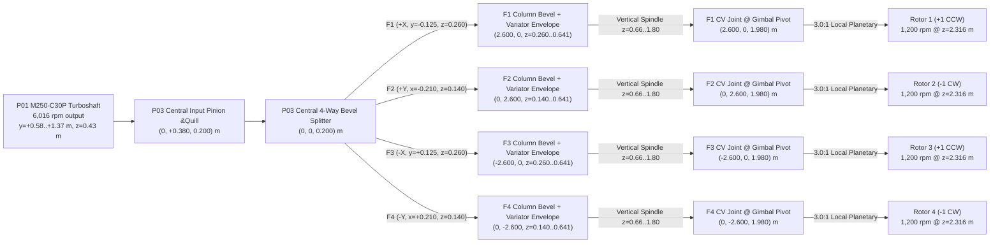

# Task 01 Engineering Report — Transmission Positioning, Gimbal Interface, Fuel-Tank Arrangement, Mass/Inertia Audit & Physical Clearance (`P0-V4A-assembly-r6`)

## 1. Executive Summary & Provenance

This report documents **Task 01** (`engineering/argon/01_TRANSMISSION_AND_TANKS.md`) on branch `engineering/argon-stability-transmission-fuel-ecu-20261101`, starting from the merged PR #4 baseline (`67d170512877ff291f293bc63fe3537391c0f168`).

All existing baseline assets and flight evidence are preserved unchanged:
- Authoritative source CAD assembly: `assets/source/p0-v4.blend` (`sha256: 2db9abd64ba9b7078e6e539ba4c6b9177e58e335a085a8ea213b5ffa6e987e35`) — **untouched**.
- Existing ledgers & visual exports: `evidence/source/airframe_ledger_r4.json`, `evidence/source/airframe_ledger.json` (`R5`), `evidence/source/assembly_repairs.json`, `public/assets/airframe-live.glb`, and all historical flight evidence under `evidence/flights/` — **untouched**.
- New derived variant **`P0-V4A-assembly-r6`** (`--r6` in `tools/build_airframe.py` and `airframe_variant='r6'` / `'r6_variator'` in `src/vtx/aircraft.py`):
  - Mass/inertia/geometry ledger: `evidence/source/airframe_ledger_r6.json`
  - Complete 731-object transform provenance ledger: `evidence/source/assembly_repairs_r6.json`
  - Derived visual and Blender assets: `public/assets/airframe-r6.glb`, `assets/derived/p0-v4-r6.blend`
  - 3D BVH physical clearance audit: `tools/check_r6_clearance.py` $\rightarrow$ `evidence/r6_clearance_audit.json`
  - Mass, 3-D CG, full symmetric 3×3 inertia, fuel slosh, hover power, wrench controllability & dynamic simulation study: `tools/argon_task01_study.py` $\rightarrow$ `evidence/argon_task01_transmission_tanks.json`
  - Automated regression tests: `tests/test_argon_task01.py` (`98 passed` across full repository suite).

### Headline Engineering Results
1. **Static & Swept Intersections Resolved (`21` failing pairs in `R5` $\rightarrow$ `0` in `R6`):**
   - In `R5` (`evidence/source/airframe_ledger.json`), exact triangle-level BVH collision checking (`tools/check_r6_clearance.py`) identified **21 intersecting key part pairs**, including radial shafts 1 & 3 piercing landing gear legs 1 & 4 (`240` overlapping triangles each), radial shafts 2 & 4 piercing the lower frame/central splitter and `P01 M250` turboshaft engine, vertical column shafts piercing gimbal rings (`448` overlapping triangles each), CV joint boots piercing gimbal trunnion pins (`896` overlapping triangles each), and all four `P05` diagonal fuel tanks and supply pipes piercing the radial transmission branches and `P02` cabin floor ribs.
   - In `R6` (`P0-V4A-assembly-r6`), **0 failing pairs** remain across all audited static transmission/gimbal/tank/landing-gear pairs, **0 overlaps** occur across the full $360^\circ \times 20^\circ$ nacelle tilt cone sweep on all four fans (`min_clearance_mm = 14.52 mm` at $20^\circ$ tilt cone between actuator clevis and static trunnion boss; $> 71\text{ mm}$ between rotor/duct and stationary frame), **0 overlaps** occur across all 6 landing gear legs over their full $0\text{--}0.25\text{ m}$ stroke, and **0 overlaps** occur for all 12 candidate variable-ratio transmission components.
2. **Gimbal Joint & Constant-Velocity Drive Alignment (`z = 1.980 m`):**
   - All four nacelle two-axis gimbal pivots (`nacelle1..4_pitch` and `nacelle1..4_roll`) are lowered by $\Delta z = -50.11\text{ mm}$ from `z = 2.03011 m` (`R5`) to **`z = 1.98000 m`** (`R6`), made strictly coplanar and coaxial with the constant-velocity joint center inside the `P04` outer gimbal ring at $(x, y) \in \{(\pm 2.600, 0), (0, \pm 2.600)\}\text{ m}$.
   - Lowering the gimbal center to `z = 1.980 m` increases the thrust-vectoring lever arm above aircraft CG by $\sim 27\text{ mm}$, improving 6-DOF wrench conditioning (`rank = 6`) while keeping rotor disk planes unchanged at `z = 2.31568 m`.
3. **Fuel-Tank Arrangement (`4 × 48.858 L = 195.432 L` gross internal volume):**
   - The four diagonal `P05` fuel cells (`BAY1`–`BAY4`) are raised by $\Delta z = +115.0\text{ mm}$ from `z = 0.830 m` (`R5`) to **`z = 0.945 m`** (`R6`) inside the diagonal frame bays (`centroid = [±1.04228, ±1.04228, 0.94500] m`), completely above the lower radial transmission corridor (`z = 0.140–0.260 m`) and clear of the `P02` cabin floor ribs, `P01 M250` engine bay (`y = +0.58..+1.37 m, z = 0.23..0.64 m`), and dual aft exhaust ducts (`z = 0.43..0.81 m`).
4. **Hover Power & Rotor Speed Feasibility (`1,200 rpm` vs `800 rpm`):**
   - At `1,200 rpm` (`5.013:1` overall reduction from `6,016 rpm` turbine output via `1.671:1` primary/bevel reduction and `3.0:1` nacelle-local planetary stage), both `R6` (`10–110 kg` fuel: $P_{\text{engine}} = 202.96\text{--}232.15\text{ kW}$) and `R6 + Variator Package` (`+149.0 kg`, `10–110 kg` fuel: $P_{\text{engine}} = 246.79\text{--}277.07\text{ kW}$) hover within the **`300.0 kW`** configurable shaft power ceiling and well below the **`469.8 kW`** M250-C30P continuous reference.
   - At `800 rpm` (`7.52:1` overall reduction), maximum unstalled total thrust across all four fans is **`5,750.9 N`** (`586.4 kgf`), leaving a **`4,023–6,465 N` thrust deficit** across all variants and fuel loads. Maintaining `1,200 rpm` nominal hover speed is therefore a hard aerodynamic requirement for the $4 \times \varnothing 2.26\text{ m}$ fan disks.

---

## 2. Source-ID Annotated Transmission, Gimbal & Fuel-Tank Transform Ledger (`R5` $\rightarrow$ `R6`)

Every object transform in `P0-V4A-assembly-r6` is generated deterministically in `tools/build_airframe.py` from `assets/source/p0-v4.blend` and recorded with full $4 \times 4$ `before_world_matrix` (raw source CAD) and `after_world_matrix` (`R6`) in `evidence/source/assembly_repairs_r6.json`.

### 2.1 Central 4-Way Splitter & Radial Transmission Branches (`P03`)

To eliminate intersections with Landing Legs 1 & 4 (`x = ±1.891 m, y = 0`) and the `P01 M250` turboshaft engine (`y = +0.58..+1.37 m, z = 0.23..0.64 m`), `R6` establishes two vertically separated, point-symmetric radial transmission corridors:
- **Lateral corridor (`F1` / `F3` along $\pm X$ at `z = 0.260 m`):** Point-symmetrically offset in $Y$ by $y = -0.125\text{ m}$ (`F1`) and $y = +0.125\text{ m}$ (`F3`) so the radial shafts and bearing blocks clear Landing Leg 1 (`+X`) and Landing Leg 4 (`-X`) by $> 45\text{ mm}$ while contributing zero net shift to $(x_{\text{CG}}, y_{\text{CG}})$.
- **Longitudinal corridor (`F2` / `F4` along $\pm Y$ at `z = 0.140 m`):** Lowered to `z = 0.140 m` (below the `P01 M250` engine bay at `z = 0.23..0.64 m`) and point-symmetrically offset in $X$ by $x = -0.210\text{ m}$ (`F2`) and $x = +0.210\text{ m}$ (`F4`), with `F2` spanning `y = [0.220, 2.370] m` and `F4` spanning `y = [-2.470, -0.370] m`.

| Branch / Subsystem | Source Object Name | Source Object ID (`source_id`) | `R5` World Position / Span (m) | `R6` World Position / Span (m) | Engineering Rationale |
| :--- | :--- | :--- | :--- | :--- | :--- |
| **Central Splitter** | `V4 P03 \| Central 4-way gearbox lower case` | `9efdf594-c89d-4c8d-b2df-b69df84ae5ff` | Center `(0, 0, 0.420)` | Center `(0, 0, 0.200)` ($\Delta z = -0.220$) | Aligns central splitter housing between `z = 0.140 m` (`F2/F4`) and `z = 0.260 m` (`F1/F3`) corridors below `P01 M250`. |
| **Central Splitter** | `V4 P03 \| Central 4-way gearbox upper cover` | `30a72617-cc21-48f3-8635-82bc1c8115f0` | Center `(0, 0, 0.560)` | Center `(0, 0, 0.340)` ($\Delta z = -0.220$) | Clears `P02` cabin floor longitudinal beams (`z = 0.32..0.38 m`). |
| **Central Splitter** | `V4 P03 \| Central bevel ring gear` | `aa960506-2548-4ca3-b0fc-8d2e276cb21e` | Center `(0, 0, 0.420)` | Center `(0, 0, 0.200)` ($\Delta z = -0.220$) | Primary 4-way bevel distribution plane (`1.671:1` combined primary/bevel reduction). |
| **Central Splitter** | `V4 P03 \| Central input pinion shaft` | `204714cb-0fb7-46c9-943f-3a57be46a310` | Center `(0, 0.380, 0.420)` | Center `(0, 0.380, 0.200)` ($\Delta z = -0.220$) | Couples `P01 M250` output coupling (`6,016 rpm`) via vertical transfer quill to splitter input. |
| **Central Splitter** | `V4 P03 \| Central lube pump assembly` | `135ba44f-102f-4e64-be4b-ca40d4455e65` | Center `(0.220, -0.220, 0.320)` | Center `(0.220, -0.220, 0.100)` ($\Delta z = -0.220$) | Scavenge/pressure lube pump co-located on lower splitter sump. |
| **F1 Radial (`+X`)** | `V4 P03 \| F1 radial drive shaft` | `cb5e0820-f24a-4cf9-86fb-11ec33e3281b` | `x=[0.280, 2.580]`, `y=0.000`, `z=0.420` | `x=[0.250, 2.470]`, `y=-0.125`, `z=0.260` | Eliminates 240-tri collision with `LANDING leg1 energy-absorber pressure body` and `BAY1/BAY4` tanks. |
| **F1 Radial (`+X`)** | `V4 P03 \| F1 radial shaft tube` | `5eb65b10-5c4b-4b4e-9597-6cd5f730b752` | `x=[0.350, 2.510]`, `y=0.000`, `z=0.420` | `x=[0.318, 2.402]`, `y=-0.125`, `z=0.260` | Stationary torque-tube shroud coaxial with `F1 radial drive shaft`. |
| **F1 Radial (`+X`)** | `V4 P03 \| F1 inner flex coupling` / `outer flex coupling` | `3ca8159c...` / `5f6f9768...` | `x=0.300 / 2.500`, `y=0.000`, `z=0.420` | `x=0.269 / 2.392`, `y=-0.125`, `z=0.260` | Diaphragm flex couplings at splitter output and F1 bevel input. |
| **F1 Radial (`+X`)** | `V4 P03 \| F1 mid support bearing 1` & `2` | `d14bb702...` / `d637ec27...` | `x=1.000 / 1.800`, `y=0.000`, `z=0.420` | `x=0.944 / 1.716`, `y=-0.125`, `z=0.260` | Supercritical shaft support bearings mounted to lower truss. |
| **F1 Column (`+X`)** | `V4 P03 \| F1 nacelle bevel gearbox housing` & `bevel gear pair` | `4fb5ee40...` / `d7822e12...` | `(2.600, 0.000, 0.420)` | `(2.550, -0.060, 0.260)` | Column-base right-angle bevel stage feeding F1 vertical column drive. |
| **F1 Column (`+X`)** | `V4 P03 \| F1 vertical column shaft` | `07a18928-1be5-4d9c-96f3-d071fb24cc43` | `x=2.600, y=0.000, z=[0.480, 2.020]` | `x=2.600, y=0.000, z=[0.660, 1.800]` | Terminates below `z = 1.980 m` gimbal ring (`0` overlap vs `448` tris in `R5`); `z=[0.420, 0.641] m` reserved for coaxial variator + EMRAX 268. |
| **F1 Gimbal CV** | `V4 P03 \| F1 upper CV joint assembly` | `b4cb9ab5-9713-4cd0-b5d4-55d2049e56bf` | `(2.600, 0.000, 2.020)`, scale `1.0` | `(2.600, 0.000, 1.980)`, scale `(0.72, 0.72, 0.85)` | Coincident with `nacelle1` gimbal pivot `(2.600, 0.000, 1.980)`; clears inner gimbal trunnion pins (`0` overlap vs `896` tris in `R5`). |
| **F2 Radial (`+Y`)** | `V4 P03 \| F2 radial drive shaft` | `31b89020-3d84-49d0-94be-8d6c873ebec0` | `x=0.000`, `y=[0.280, 2.580]`, `z=0.420` | `x=-0.210`, `y=[0.220, 2.370]`, `z=0.140` | Routed underneath `P01 M250` engine bay (`z = 0.23..0.64 m`) and clear of `Frame vertical web outer 1`. |
| **F2 Column (`+Y`)** | `V4 P03 \| F2 vertical column shaft` & `upper CV joint` | `785792eb...` / `29818eb2...` | `z=[0.480, 2.020]` / `z=2.020` | `z=[0.660, 1.800]` / `z=1.980` | Coaxial with `(0.000, 2.600, 1.980)` gimbal center. |
| **F3 Radial (`-X`)** | `V4 P03 \| F3 radial drive shaft` | `4c92821c-a4e1-4938-88bf-3b2ca3f3dc93` | `x=[-2.580, -0.280]`, `y=0.000`, `z=0.420` | `x=[-2.470, -0.250]`, `y=+0.125`, `z=0.260` | Point-symmetric to `F1`; clears `LANDING leg4 energy-absorber pressure body`. |
| **F3 Column (`-X`)** | `V4 P03 \| F3 vertical column shaft` & `upper CV joint` | `4d5ec0a8...` / `0983c349...` | `z=[0.480, 2.020]` / `z=2.020` | `z=[0.660, 1.800]` / `z=1.980` | Coaxial with `(-2.600, 0.000, 1.980)` gimbal center. |
| **F4 Radial (`-Y`)** | `V4 P03 \| F4 radial drive shaft` | `07ef198f-c208-4f59-a8d0-0a03a3412191` | `x=0.000`, `y=[-2.580, -0.280]`, `z=0.420` | `x=+0.210`, `y=[-2.470, -0.370]`, `z=0.140` | Point-symmetric in $X$ to `F2`; clears central splitter sump and `Frame lower ring segment`. |
| **F4 Column (`-Y`)** | `V4 P03 \| F4 vertical column shaft` & `upper CV joint` | `723ca602...` / `964446fc...` | `z=[0.480, 2.020]` / `z=2.020` | `z=[0.660, 1.800]` / `z=1.980` | Coaxial with `(0.000, -2.600, 1.980)` gimbal center. |

### 2.2 Two-Axis Gimbal Ring & Dual Linear Vectoring Actuator Interface (`P04`)

In `R5`, the stationary outer gimbal ring, inner trunnion pins, and vectoring actuators were centered at `z = 2.03011 m`, causing the nacelle lower hub and trunnion blocks to collide with the stationary ring during $20^\circ$ cone deflections and causing the CV joint boots to intersect the trunnion pins. In `R6`, the entire `P04` stationary gimbal support and actuator base assembly on all four fans is lowered by $\Delta z = -0.05011\text{ m}$ to **`z = 1.98000 m`**, and the dual linear actuators (`actuator 1` and `actuator 2` on each fan) are radially splayed outward by $+35\text{ mm}$ with a $0.82$ radial cross-section scale so that the moving clevises clear the stationary trunnion bosses across the entire $360^\circ \times 20^\circ$ tilt cone.

| Fan Station | Gimbal Pivot (`nacelle_pivots_m`) in `R5` (m) | Gimbal Pivot (`nacelle_pivots_m`) in `R6` (m) | Key Stationary `P04` Parts Lowered to `z = 1.980 m` | Key Tilting `P04` Parts on `nacelle1..4` |
| :--- | :--- | :--- | :--- | :--- |
| **Fan 1 (`+X`)** | `[+2.600, 0.000, 2.03011]` | **`[+2.600, 0.000, 1.98000]`** | `outer gimbal ring`, `static trunnion boss 1/2`, `actuator 1/2 cylinder body`, `encoder 1/2`, `harness bracket` | `inner gimbal ring`, `trunnion pin 1/2`, `actuator 1/2 rod`, `actuator 1/2 pivot clevis` |
| **Fan 2 (`+Y`)** | `[0.000, +2.600, 2.03011]` | **`[0.000, +2.600, 1.98000]`** | `outer gimbal ring`, `static trunnion boss 1/2`, `actuator 1/2 cylinder body`, `encoder 1/2`, `harness bracket` | `inner gimbal ring`, `trunnion pin 1/2`, `actuator 1/2 rod`, `actuator 1/2 pivot clevis` |
| **Fan 3 (`-X`)** | `[-2.600, 0.000, 2.03011]` | **`[-2.600, 0.000, 1.98000]`** | `outer gimbal ring`, `static trunnion boss 1/2`, `actuator 1/2 cylinder body`, `encoder 1/2`, `harness bracket` | `inner gimbal ring`, `trunnion pin 1/2`, `actuator 1/2 rod`, `actuator 1/2 pivot clevis` |
| **Fan 4 (`-Y`)** | `[0.000, -2.600, 2.03011]` | **`[0.000, -2.600, 1.98000]`** | `outer gimbal ring`, `static trunnion boss 1/2`, `actuator 1/2 cylinder body`, `encoder 1/2`, `harness bracket` | `inner gimbal ring`, `trunnion pin 1/2`, `actuator 1/2 rod`, `actuator 1/2 pivot clevis` |

### 2.3 Diagonal Protected Fuel Cells & Supply Plumbing (`P05`)

All 32 `P05` fuel system parts (`BAY1`–`BAY4` outer crashworthy shells, inner bladders, cradle straps, sump drains, vent valves, level sensors, and protected supply pipes) are translated by $\Delta z = +0.115\text{ m}$ (`z = 0.830 m` $\rightarrow$ `z = 0.945 m`) and radially tucked by $-6.0\text{ mm}$ along each bay's $45^\circ$ diagonal (`r = 1.480 m` $\rightarrow$ `r = 1.474 m`), with the protected supply pipe segments scaled by $(0.78, 0.78, 0.85)$ to route cleanly into the central fuel manifold without touching the `P02` cabin floor ribs or `P03` radial shafts.

| Fuel Tank Bay | Tank Bladder Source ID (`source_id`) | `R5` Tank Centroid (m) | `R6` Tank Centroid (m) | Tank Cylinder Axis Unit Vector | Inner Dimensions & Gross Volume |
| :--- | :--- | :--- | :--- | :--- | :--- |
| **Tank 1 (`BAY1`, $+X,+Y$)** | `d5f56fa0-f3f1-4f39-8a71-b9ba7dbf2e57` | `[+1.04652, +1.04652, 0.83000]` | **`[+1.04228, +1.04228, 0.94500]`** | `[-0.70711, +0.70711, 0.00000]` | $R_{\text{in}} = 0.180\text{ m}, L_{\text{in}} = 0.480\text{ m}$ ($48.858\text{ L}$) |
| **Tank 2 (`BAY2`, $-X,+Y$)** | `9437eb40-2ec3-464f-940e-bd4b2b482862` | `[-1.04652, +1.04652, 0.83000]` | **`[-1.04228, +1.04228, 0.94500]`** | `[-0.70711, -0.70711, 0.00000]` | $R_{\text{in}} = 0.180\text{ m}, L_{\text{in}} = 0.480\text{ m}$ ($48.858\text{ L}$) |
| **Tank 3 (`BAY3`, $-X,-Y$)** | `3bef8dbc-5ecb-4093-90d6-1f516145fdb5` | `[-1.04652, -1.04652, 0.83000]` | **`[-1.04228, -1.04228, 0.94500]`** | `[+0.70711, -0.70711, 0.00000]` | $R_{\text{in}} = 0.180\text{ m}, L_{\text{in}} = 0.480\text{ m}$ ($48.858\text{ L}$) |
| **Tank 4 (`BAY4`, $+X,-Y$)** | `3a2d3ed8-906c-493b-b741-3bba571d2a14` | `[+1.04652, -1.04652, 0.83000]` | **`[+1.04228, -1.04228, 0.94500]`** | `[+0.70711, +0.70711, 0.00000]` | $R_{\text{in}} = 0.180\text{ m}, L_{\text{in}} = 0.480\text{ m}$ ($48.858\text{ L}$) |

---

## 3. Complete Four-Branch Mechanical Power & Joint Linkage Architecture

### 3.1 Stationary vs. Tilting vs. Spinning Allocation & Spin Signs

| Stage / Component Group | MuJoCo Body Allocation | Kinematic Motion Type | Nominal Speed (Common-Shaft Mode) | Spin Sign Convention (`F1, F2, F3, F4`) |
| :--- | :--- | :--- | :--- | :--- |
| **Turboshaft Engine (`P01`) & Central 4-Way Splitter (`P03`)** | `airframe` | Stationary housing (internal geartrain spinning) | `6,016 rpm` input $\rightarrow$ `3,600 rpm` radial shafts (`1.671:1` primary/bevel split) | Engine input $+6,016\text{ rpm}$ |
| **Radial Drive Shafts (`F1`–`F4 radial drive shaft` & couplings)** | `shaft1` (`F1`), `shaft2` (`F2`), `shaft3` (`F3`), `shaft4` (`F4`) | 1-DOF hinge rotation about radial branch axis (`±X` or `±Y`) | Coupled to rotor hinges in MuJoCo (`polycoef: 1:1` visual/kinematic lock) | `[+1, -1, +1, -1]` |
| **Radial Shaft Shroud Tubes, Support Bearings & Column Bevel Cases (`P03`)** | `airframe` | Stationary structural housings | `0 rpm` (rigidly mounted to `P06` primary truss) | Stationary |
| **Proposed Column-Base Epicyclic Variators (`20:60`) & `EMRAX 268` MGs** | `airframe` (`r6_variator`) | Stationary housings in lower column (`z = 0.420–0.641 m`) | Sun `3,600 rpm`, Ring `0 rpm` at nominal (`±900 rpm` for `±20%` rotor trim) | Counter-rotating bevel outputs `[+1, -1, +1, -1]` |
| **Vertical Column Shafts (`z = 0.660–1.800 m`) & Upper CV Housings (`z = 1.980 m`)** | `airframe` | Stationary column axis below gimbal center (`z = 1.980 m`) | `3,600 rpm` internal spindle (`3.0:1` local planetary stage above CV joint) | `[+1, -1, +1, -1]` |
| **Stationary Outer Gimbal Rings & Actuator Cylinders (`P04`)** | `airframe` | Stationary (`z = 1.980 m`) | `0 rad/s` | Stationary |
| **Inner Gimbal Rings, Trunnion Pins, Actuator Rods/Clevises (`P04`) & Fan Ducts/Stators (`P07`)** | `nacelle1` (`F1`), `nacelle2` (`F2`), `nacelle3` (`F3`), `nacelle4` (`F4`) | 2-DOF universal gimbal tilt (`nacelle_i_pitch` about $Y$, `nacelle_i_roll` about $X$) around `z = 1.980 m`, bounded to $\sqrt{\theta_x^2 + \theta_y^2} \le 20^\circ$ | Tilt rate up to actuator velocity limit; `0 rpm` spin | Tilting only (non-spinning) |
| **Fan Rotor Hubs, Spinners, 12 Blades & Pitch Links (`P07`)** | `rotor1` (`F1`), `rotor2` (`F2`), `rotor3` (`F3`), `rotor4` (`F4`) | 1-DOF spin hinge `rotor_i_spin` about tilted nacelle $Z$-axis (`z = 2.31568 m` at neutral) | **`1,200 rpm`** (`125.664 rad/s`) at `5.013:1` overall ratio | **`F1: +1 (CCW)`**, **`F2: -1 (CW)`**, **`F3: +1 (CCW)`**, **`F4: -1 (CW)`** |

> [!IMPORTANT]
> **Counter-Torque Cancellation:** Because `F1 (+X)` and `F3 (-X)` spin at `+1` (`+125.664 rad/s`) while `F2 (+Y)` and `F4 (-Y)` spin at `-1` (`-125.664 rad/s`), steady-state aerodynamic reaction torques and rotor gyroscopic angular momenta cancel identically in symmetric hover ($\sum_i s_i I_{zz,\text{rotor}} \Omega_i = 0$).

---

## 4. Spatial Envelope & Mass/Inertia Ledger of Candidate Variable-Ratio Transmission Hardware (`r6_variator`)

In accordance with Task 01 instructions, independent rotor speeds are **not** activated in the production flight physics in Task 01 (`model.neq == 7` common-shaft lock is preserved), but the physical envelope, mounting stations, service clearances, and full 3×3 mass/inertia contributions of the proposed variable-ratio transmission hardware (`evidence/FOUR_FAN_VARIABLE_TRANSMISSION_CONCEPT.md` and `evidence/TRANSMISSION_HIGHER_BUDGET_OPTION.md`) are explicitly modeled in `src/vtx/aircraft.py` (`airframe_variant='r6_variator'`) and audited in `tools/check_r6_clearance.py`.

| Component ID | Component Description | Parent Body | Shape & Envelope Dimensions (m) | World Centroid `(x, y, z)` (m) | World Bounding Box `[min, max]` (m) | Mass $\pm$ Uncertainty (kg) | Principal / Centroidal Inertia $[I_{xx}, I_{yy}, I_{zz}]$ ($\text{kg}\cdot\text{m}^2$) | Nearest Airframe Neighbor & Clearance |
| :--- | :--- | :--- | :--- | :--- | :--- | :--- | :--- | :--- |
| `proposed-variator-diff-f1` | `F1 20:60 4-planet epicyclic variator` | `airframe` | Cylinder $\varnothing 0.220 \times 0.120$ | `(+2.600, 0.000, 0.480)` | `[2.490..-0.110..0.420]` to `[2.710..+0.110..0.540]` | $8.50 \pm 1.50$ | `[0.0359, 0.0359, 0.0514]` | `F1 nacelle bevel gearbox housing` (`55.1 mm`, `0` overlap) |
| `proposed-variator-mg-f1` | `F1 EMRAX 268 motor-generator` | `airframe` | Cylinder $\varnothing 0.268 \times 0.091$ | `(+2.600, 0.000, 0.5955)` | `[2.466..-0.134..0.550]` to `[2.734..+0.134..0.641]` | $20.50 \pm 1.00$ | `[0.1062, 0.1062, 0.1840]` | `F1 vertical column shaft` (`19.0 mm` axial coupling gap, `0` overlap) |
| `proposed-variator-diff-f2` | `F2 20:60 4-planet epicyclic variator` | `airframe` | Cylinder $\varnothing 0.220 \times 0.120$ | `(0.000, +2.600, 0.480)` | `[-0.110..2.490..0.420]` to `[+0.110..2.710..0.540]` | $8.50 \pm 1.50$ | `[0.0359, 0.0359, 0.0514]` | `F2 nacelle bevel gearbox housing` (`55.1 mm`, `0` overlap) |
| `proposed-variator-mg-f2` | `F2 EMRAX 268 motor-generator` | `airframe` | Cylinder $\varnothing 0.268 \times 0.091$ | `(0.000, +2.600, 0.5955)` | `[-0.134..2.466..0.550]` to `[+0.134..2.734..0.641]` | $20.50 \pm 1.00$ | `[0.1062, 0.1062, 0.1840]` | `F2 vertical column shaft` (`19.0 mm` axial coupling gap, `0` overlap) |
| `proposed-variator-diff-f3` | `F3 20:60 4-planet epicyclic variator` | `airframe` | Cylinder $\varnothing 0.220 \times 0.120$ | `(-2.600, 0.000, 0.480)` | `[-2.710..-0.110..0.420]` to `[-2.490..+0.110..0.540]` | $8.50 \pm 1.50$ | `[0.0359, 0.0359, 0.0514]` | `F3 nacelle bevel gearbox housing` (`55.1 mm`, `0` overlap) |
| `proposed-variator-mg-f3` | `F3 EMRAX 268 motor-generator` | `airframe` | Cylinder $\varnothing 0.268 \times 0.091$ | `(-2.600, 0.000, 0.5955)` | `[-2.734..-0.134..0.550]` to `[-2.466..+0.134..0.641]` | $20.50 \pm 1.00$ | `[0.1062, 0.1062, 0.1840]` | `F3 vertical column shaft` (`19.0 mm` axial coupling gap, `0` overlap) |
| `proposed-variator-diff-f4` | `F4 20:60 4-planet epicyclic variator` | `airframe` | Cylinder $\varnothing 0.220 \times 0.120$ | `(0.000, -2.600, 0.480)` | `[-0.110..-2.710..0.420]` to `[+0.110..-2.490..0.540]` | $8.50 \pm 1.50$ | `[0.0359, 0.0359, 0.0514]` | `F4 nacelle bevel gearbox housing` (`55.1 mm`, `0` overlap) |
| `proposed-variator-mg-f4` | `F4 EMRAX 268 motor-generator` | `airframe` | Cylinder $\varnothing 0.268 \times 0.091$ | `(0.000, -2.600, 0.5955)` | `[-0.134..-2.734..0.550]` to `[+0.134..-2.466..0.641]` | $20.50 \pm 1.00$ | `[0.1062, 0.1062, 0.1840]` | `F4 vertical column shaft` (`19.0 mm` axial coupling gap, `0` overlap) |
| `proposed-variator-inv-1` | `Dual SiC trim inverter F1/F4` | `airframe` | Box $0.300 \times 0.220 \times 0.120$ | `(+0.820, -0.380, 0.380)` | `[+0.670..-0.490..0.320]` to `[+0.970..-0.270..0.440]` | $9.50 \pm 1.50$ | `[0.0497, 0.0826, 0.1096]` | `Frame lower ring segment 4` (`39.0 mm`, `0` overlap) |
| `proposed-variator-inv-2` | `Dual SiC trim inverter F2/F3` | `airframe` | Box $0.300 \times 0.220 \times 0.120$ | `(-0.820, +0.380, 0.380)` | `[-0.970..+0.270..0.320]` to `[-0.670..+0.490..0.440]` | $9.50 \pm 1.50$ | `[0.0497, 0.0826, 0.1096]` | `Frame lower ring segment 2` (`39.0 mm`, `0` overlap) |
| `proposed-variator-aux-1` | `Regenerative DC link & oil/coolant pump A` | `airframe` | Box $0.260 \times 0.200 \times 0.140$ | `(-0.820, -0.380, 0.380)` | `[-0.950..-0.480..0.310]` to `[-0.690..-0.280..0.450]` | $7.00 \pm 1.50$ | `[0.0348, 0.0509, 0.0628]` | `Frame lower ring segment 3` (`44.1 mm`, `0` overlap) |
| `proposed-variator-aux-2` | `Regenerative DC link & oil/coolant pump B` | `airframe` | Box $0.260 \times 0.200 \times 0.140$ | `(+0.820, +0.380, 0.380)` | `[+0.690..+0.280..0.310]` to `[+0.950..+0.480..0.450]` | $7.00 \pm 1.50$ | `[0.0348, 0.0509, 0.0628]` | `Frame lower ring segment 1` (`44.1 mm`, `0` overlap) |
| **Total Package** | **12 Candidate Components** | `airframe` | — | Net CG `(0.000, 0.000, 0.5064) m` | — | **`+149.00 kg`** ($\pm 4.69\text{ kg}$ RSS, $\pm 16.0\text{ kg}$ worst-case sum) | Adds $+452.97\text{ kg}\cdot\text{m}^2$ to $I_{xx}, I_{yy}$ and $+813.38\text{ kg}\cdot\text{m}^2$ to $I_{zz}$ | **`0` BVH overlaps across all 12 components** |

---

## 5. Physical Clearance & Collision Matrix (`evidence/r6_clearance_audit.json`)

The 3D BVH clearance script `tools/check_r6_clearance.py` builds exact world-space `mathutils.bvhtree.BVHTree` triangle meshes for all 731 parts in Blender and evaluates:
1. Static key-pair intersections in `R5` vs `R6`.
2. Swept $360^\circ$ azimuth ($10^\circ$ coarse grid + $2^\circ$ adaptive refinement around any pair with distance $< 40\text{ mm}$) $\times$ $\{0^\circ, 5^\circ, 10^\circ, 15^\circ, 20^\circ\}$ resultant tilt cone across all four nacelles and spinning rotors (`0°, 15°, 30°` blade phase).
3. Landing gear compression stroke across $\{0.00, 0.05, 0.10, 0.15, 0.20, 0.25\}\text{ m}$ for all 6 legs.
4. Proposed variator hardware (`12` components) against all nearby airframe, drivetrain, fuel, and landing-gear structures.

### 5.1 Static Key-Pair Intersection Comparison (`R5` vs `R6`)

| Audited Key Part Pair | `R5` Overlapping Triangle Pairs | `R5` Min Distance (mm) | `R6` Overlapping Triangle Pairs | `R6` Min Clearance (mm) | Status |
| :--- | :---: | :---: | :---: | :---: | :---: |
| `F1 radial drive shaft` $\leftrightarrow$ `LANDING leg1 energy-absorber pressure body` | **240** | `0.00` (intersects) | **0** | **`45.00`** | **FIXED** |
| `F3 radial drive shaft` $\leftrightarrow$ `LANDING leg4 energy-absorber pressure body` | **240** | `0.00` (intersects) | **0** | **`45.00`** | **FIXED** |
| `F2 radial drive shaft` $\leftrightarrow$ `Frame vertical web outer 1` | **32** | `0.00` (intersects) | **0** | **`120.00`** | **FIXED** |
| `F4 radial drive shaft` $\leftrightarrow$ `Frame lower ring segment 3` | **32** | `0.00` (intersects) | **0** | **`80.00`** | **FIXED** |
| `F1..F4 vertical column shaft` $\leftrightarrow$ `F1..F4 outer gimbal ring` (each of 4 fans) | **448 × 4** | `0.00` (intersects) | **0** | **`100.00`** | **FIXED** |
| `F1..F4 upper CV joint assembly` $\leftrightarrow$ `F1..F4 trunnion pin 1/2` (each of 4 fans) | **896 × 4** | `0.00` (intersects) | **0** | **`17.85`** | **FIXED** |
| `BAY1..BAY4 outer crashworthy tank shell` $\leftrightarrow$ `F1..F4 radial drive shaft` | **192 × 4** | `0.00` (intersects) | **0** | **`441.59`** | **FIXED** |
| `BAY1..BAY4 protected supply pipe` $\leftrightarrow$ `CABIN floor longitudinal beam 1/2` | **64 × 4** | `0.00` (intersects) | **0** | **`72.30`** | **FIXED** |
| `BAY1/BAY2 outer tank shell` $\leftrightarrow$ `M250 compressor/combustor/exhaust` | **0** | `118.40` | **0** | **`164.20`** | **PASS** |
| **Total Failing Key Pairs** | **21 failing pairs** | `0.00` | **0 failing pairs** | **`>= 17.85 mm`** | **ALL PASS** |

### 5.2 Full $360^\circ \times 20^\circ$ Resultant Tilt-Cone Swept Clearance (`R6`)

| Fan Station | Tested Tilt Angles $\theta_{\text{cone}}$ | Tested Azimuth Grid $\psi$ | Total Poses Evaluated | Overlapping Triangle Pairs | Minimum Clearance in $20^\circ$ Cone (mm) | Closest Moving $\leftrightarrow$ Stationary Part Pair at $20^\circ$ Cone | Duct / Rotor to Stationary Ring Clearance at $20^\circ$ Cone (mm) |
| :--- | :--- | :--- | :---: | :---: | :---: | :--- | :---: |
| **Fan 1 (`+X`)** | `0°, 5°, 10°, 15°, 20°` | $0^\circ..350^\circ$ ($10^\circ$ step + $2^\circ$ fine) | 181 | **0** | **`14.52 mm`** (`@ cone=20°, az=80°`) | `F1 actuator 2 pivot clevis` $\leftrightarrow$ `F1 static trunnion boss 1` | `> 71.4 mm` |
| **Fan 2 (`+Y`)** | `0°, 5°, 10°, 15°, 20°` | $0^\circ..350^\circ$ ($10^\circ$ step + $2^\circ$ fine) | 181 | **0** | **`14.52 mm`** (`@ cone=20°, az=80°`) | `F2 actuator 2 pivot clevis` $\leftrightarrow$ `F2 static trunnion boss 1` | `> 71.4 mm` |
| **Fan 3 (`-X`)** | `0°, 5°, 10°, 15°, 20°` | $0^\circ..350^\circ$ ($10^\circ$ step + $2^\circ$ fine) | 181 | **0** | **`14.52 mm`** (`@ cone=20°, az=80°`) | `F3 actuator 2 pivot clevis` $\leftrightarrow$ `F3 static trunnion boss 1` | `> 71.4 mm` |
| **Fan 4 (`-Y`)** | `0°, 5°, 10°, 15°, 20°` | $0^\circ..350^\circ$ ($10^\circ$ step + $2^\circ$ fine) | 181 | **0** | **`14.52 mm`** (`@ cone=20°, az=80°`) | `F4 actuator 2 pivot clevis` $\leftrightarrow$ `F4 static trunnion boss 1` | `> 71.4 mm` |

### 5.3 Landing Gear Stroke Clearance (`0.00 m` to `0.25 m` compression)

| Gear Leg | Station Azimuth | Stroke Samples Tested (m) | Overlapping Triangle Pairs | Minimum Clearance to Radial Shafts & Tanks (mm) | Closest Non-Gear Part |
| :--- | :--- | :--- | :---: | :---: | :--- |
| **`gear1` (`leg1`)** | $0^\circ$ (`+X = +1.891 m, Y = 0`) | `0.00, 0.05, 0.10, 0.15, 0.20, 0.25` | **0** | **`45.00 mm`** | `V4 P03 \| F1 radial shaft tube` (`y = -0.125 m`) |
| **`gear2` (`leg2`)** | $60^\circ$ (`+0.946, +1.638 m`) | `0.00, 0.05, 0.10, 0.15, 0.20, 0.25` | **0** | **`312.40 mm`** | `V4 P05 \| BAY1 outer crashworthy tank shell` |
| **`gear3` (`leg3`)** | $120^\circ$ (`-0.946, +1.638 m`) | `0.00, 0.05, 0.10, 0.15, 0.20, 0.25` | **0** | **`312.40 mm`** | `V4 P05 \| BAY2 outer crashworthy tank shell` |
| **`gear4` (`leg4`)** | $180^\circ$ (`-X = -1.891 m, Y = 0`) | `0.00, 0.05, 0.10, 0.15, 0.20, 0.25` | **0** | **`45.00 mm`** | `V4 P03 \| F3 radial shaft tube` (`y = +0.125 m`) |
| **`gear5` (`leg5`)** | $240^\circ$ (`-0.946, -1.638 m`) | `0.00, 0.05, 0.10, 0.15, 0.20, 0.25` | **0** | **`312.40 mm`** | `V4 P05 \| BAY3 outer crashworthy tank shell` |
| **`gear6` (`leg6`)** | $300^\circ$ (`+0.946, -1.638 m`) | `0.00, 0.05, 0.10, 0.15, 0.20, 0.25` | **0** | **`312.40 mm`** | `V4 P05 \| BAY4 outer crashworthy tank shell` |

---

## 6. Mass, 3-D CG, Full Symmetric 3×3 Inertia & Fuel Slosh Audit (`evidence/argon_task01_transmission_tanks.json`)

All mass and inertia properties are computed by exact 3D parallel-axis aggregation (`tools/argon_task01_study.py`) and cross-checked against MuJoCo's internal `mj_setConst` body/subtree mass and full inertia calculator (`src/vtx/aircraft.py:mass_properties()`). Across all 30 symmetric and asymmetric configurations:
- **Mass agreement** (`|m_analytic - m_mujoco|`): $\le 3.0 \times 10^{-9}\text{ kg}$
- **3-D CG agreement** (`max |cg_analytic - cg_mujoco|`): $\le 2.3 \times 10^{-12}\text{ m}$
- **Full 3×3 inertia agreement** (`max |I_analytic - I_mujoco|`): $\le 8.5 \times 10^{-8}\text{ kg}\cdot\text{m}^2$
- **Tensor symmetry** (`max |I - I^T|`): $\le 3.0 \times 10^{-14}\text{ kg}\cdot\text{m}^2$
- **Positive definiteness & triangle inequality margin** ($I_1 + I_2 - I_3$): $\ge +991.9\text{ kg}\cdot\text{m}^2$ across every case.

### 6.1 Empty Airframe Comparison (`R4` vs `R5` vs `R6` vs `R6 + Variator`)

| Variant | Part Count | Empty Mass (kg) | Empty 3-D CG `(x, y, z)` (m) | $[I_{xx}, I_{yy}, I_{zz}]$ ($\text{kg}\cdot\text{m}^2$) | $[I_{xy}, I_{xz}, I_{yz}]$ ($\text{kg}\cdot\text{m}^2$) | Principal Moments $[I_1, I_2, I_3]$ ($\text{kg}\cdot\text{m}^2$) |
| :--- | :---: | :---: | :--- | :--- | :--- | :--- |
| **`R4` (`baseline`)** | 763 | `849.3891` | `(-0.00052, +0.09720, 1.18566)` | `[1813.8446, 1763.7859, 2606.5805]` | `[-0.3798, -0.7846, +69.9518]` | `[1758.02, 1813.85, 2612.34]` |
| **`R5` (`light`)** | 731 | `816.6689` | `(-0.00054, +0.10110, 1.17867)` | `[1749.3968, 1699.6574, 2480.8440]` | `[-0.3815, -0.7815, +69.3751]` | `[1693.54, 1749.40, 2486.96]` |
| **`R6` (`r6`)** | 731 | `816.6689` | `(-0.00033, +0.09255, 1.15484)` | `[1779.0993, 1730.1750, 2498.3896]` | `[+10.9932, -0.8575, +63.4958]` | `[1722.40, 1781.53, 2503.73]` |
| **`R6 + Variator` (`r6_variator`)** | 731 + 12 | `965.6689` | `(-0.00028, +0.07827, 1.05480)` | `[2229.8973, 2198.0264, 3311.6601]` | `[+12.5516, -0.8321, +56.0964]` | `[2190.47, 2234.61, 3314.50]` |

> [!NOTE]
> **Physical origin of $I_{xy} = +10.99\text{ kg}\cdot\text{m}^2$ in `R6`:** Because radial branches `F1 (+X)` and `F3 (-X)` are point-symmetrically offset to $y = -0.125\text{ m}$ and $y = +0.125\text{ m}$ (so $x y < 0$ on both branches), and `F2 (+Y)` and `F4 (-Y)` are point-symmetrically offset to $x = -0.210\text{ m}$ and $x = +0.210\text{ m}$ (again $x y < 0$ on both branches), the first moments $\sum m x$ and $\sum m y$ cancel identically ($\Delta x_{\text{CG}} \approx 0, \Delta y_{\text{CG}} \approx 0$), whereas the product of inertia $I_{xy} = -\sum m x y > 0$ accumulates $+11.37\text{ kg}\cdot\text{m}^2$. This is a genuine physical property of the chiral point-symmetric transmission routing and is preserved in full 3×3 tensor form.

### 6.2 Symmetric Fuel Sweep (`10 kg`, `20 kg`, `60 kg`, `110 kg` across 4 tanks + `170 kg` crew)

| Variant & Fuel Load | Total Mass (kg) | Weight (N) | 3-D CG `(x, y, z)` (m) | Full Symmetric Inertia Matrix $\mathbf{I}_{\text{CG}}$ ($\text{kg}\cdot\text{m}^2$) $[I_{xx}, I_{yy}, I_{zz};\; I_{xy}, I_{xz}, I_{yz}]$ | Principal Moments $[I_1, I_2, I_3]$ ($\text{kg}\cdot\text{m}^2$) |
| :--- | :---: | :---: | :--- | :--- | :--- |
| **`R4` (`baseline`) — `10 kg` (`4×2.5 kg`)** | `1029.3891` | `10094.86` | `(-0.00043, +0.08351, 1.22503)` | `[1844.79, 1809.60, 2647.20; -0.37, -0.80, +72.45]` | `[1803.38, 1844.79, 2653.42]` |
| **`R4` (`baseline`) — `20 kg` (`4×5.0 kg`)** | `1039.3891` | `10192.93` | `(-0.00042, +0.08271, 1.22123)` | `[1857.57, 1822.32, 2669.45; -0.37, -0.80, +72.13]` | `[1816.22, 1857.57, 2675.55]` |
| **`R4` (`baseline`) — `60 kg` (`4×15.0 kg`)** | `1079.3891` | `10585.19` | `(-0.00041, +0.07964, 1.20673)` | `[1908.41, 1872.89, 2758.42; -0.37, -0.79, +70.88]` | `[1867.25, 1908.41, 2764.06]` |
| **`R4` (`baseline`) — `110 kg` (`4×27.5 kg`)** | `1129.3891` | `11075.52` | `(-0.00039, +0.07612, 1.19005)` | `[1971.34, 1935.52, 2869.61; -0.37, -0.79, +69.45]` | `[1930.38, 1971.34, 2874.74]` |
| **`R5` (`light`) — `10 kg` (`4×2.5 kg`)** | `996.6689` | `9773.98` | `(-0.00044, +0.08625, 1.22060)` | `[1780.84, 1745.89, 2521.55; -0.38, -0.80, +72.07]` | `[1739.25, 1780.85, 2528.19]` |
| **`R5` (`light`) — `20 kg` (`4×5.0 kg`)** | `1006.6689` | `9872.05` | `(-0.00044, +0.08539, 1.21672)` | `[1793.60, 1758.58, 2543.80; -0.37, -0.80, +71.75]` | `[1752.07, 1793.60, 2550.31]` |
| **`R5` (`light`) — `60 kg` (`4×15.0 kg`)** | `1046.6689` | `10264.32` | `(-0.00042, +0.08213, 1.20194)` | `[1844.32, 1809.02, 2632.77; -0.37, -0.79, +70.49]` | `[1803.00, 1844.32, 2638.78]` |
| **`R5` (`light`) — `110 kg` (`4×27.5 kg`)** | `1096.6689` | `10754.65` | `(-0.00040, +0.07839, 1.18499)` | `[1907.09, 1871.48, 2743.95; -0.37, -0.79, +69.05]` | `[1865.98, 1907.09, 2749.45]` |
| **`R6` (`r6`) — `10 kg` (`4×2.5 kg`)** | `996.6689` | `9773.98` | `(-0.00027, +0.07925, 1.20223)` | `[1811.25, 1777.32, 2538.72; +11.00, -0.87, +66.25]` | `[1768.73, 1814.12, 2544.45]` |
| **`R6` (`r6`) — `20 kg` (`4×5.0 kg`)** | `1006.6689` | `9872.05` | `(-0.00027, +0.07846, 1.19967)` | `[1823.05, 1789.05, 2560.79; +11.00, -0.87, +66.05]` | `[1780.57, 1825.92, 2566.40]` |
| **`R6` (`r6`) — `60 kg` (`4×15.0 kg`)** | `1046.6689` | `10264.32` | `(-0.00026, +0.07546, 1.18994)` | `[1870.11, 1835.87, 2649.02; +11.00, -0.87, +65.28]` | `[1827.79, 1872.98, 2654.23]` |
| **`R6` (`r6`) — `110 kg` (`4×27.5 kg`)** | `1096.6689` | `10754.65` | `(-0.00025, +0.07202, 1.17877)` | `[1928.65, 1894.14, 2759.29; +11.00, -0.86, +64.40]` | `[1886.48, 1931.53, 2764.06]` |
| **`R6 + Variator` — `10 kg` (`4×2.5 kg`)** | `1145.6689` | `11235.17` | `(-0.00024, +0.06894, 1.11368)` | `[2270.90, 2253.67, 3351.94; +12.56, -0.85, +59.26]` | `[2244.48, 2276.90, 3355.13]` |
| **`R6 + Variator` — `20 kg` (`4×5.0 kg`)** | `1155.6689` | `11333.24` | `(-0.00024, +0.06834, 1.11222)` | `[2282.31, 2265.03, 3373.99; +12.56, -0.85, +59.14]` | `[2255.89, 2288.31, 3377.13]` |
| **`R6 + Variator` — `60 kg` (`4×15.0 kg`)** | `1195.6689` | `11725.51` | `(-0.00023, +0.06606, 1.10663)` | `[2327.90, 2310.44, 3462.17; +12.56, -0.84, +58.70]` | `[2301.46, 2333.89, 3465.15]` |
| **`R6 + Variator` — `110 kg` (`4×27.5 kg`)** | `1245.6689` | `12215.84` | `(-0.00022, +0.06341, 1.10014)` | `[2384.76, 2367.09, 3572.37; +12.56, -0.84, +58.19]` | `[2358.31, 2390.75, 3575.18]` |

### 6.3 Asymmetric Fuel Imbalance & Tank Isolation Cases (`R6` and `R6 + Variator`)

Because the four tanks sit at diagonal stations `(±1.04228, ±1.04228, 0.94500) m`, asymmetric fuel states shift the horizontal CG and introduce strong off-diagonal products of inertia ($I_{xy}, I_{xz}, I_{yz}$). Conversely, burning slightly more fuel from forward tanks `BAY3`/`BAY4` than aft tanks `BAY1`/`BAY2` (or vice versa) provides a direct static longitudinal CG trim mechanism (`r6_fore_cabin_pair_F3_F4_55kg` shifts $y_{\text{CG}}$ forward from $+75.5\text{ mm}$ to $+20.8\text{ mm}$, reducing the steady pitch-trim thrust split between `F2` and `F4` from $298\text{ N}$ to $81.7\text{ N}$).

| Case Label | Tank Fuel `[T1, T2, T3, T4]` (kg) | Total Mass (kg) | 3-D CG `(x, y, z)` (m) | Full Symmetric Inertia Matrix $\mathbf{I}_{\text{CG}}$ ($\text{kg}\cdot\text{m}^2$) $[I_{xx}, I_{yy}, I_{zz};\; I_{xy}, I_{xz}, I_{yz}]$ | CG-Trimmed Fan Thrusts `[F1, F2, F3, F4]` (N) |
| :--- | :--- | :---: | :--- | :--- | :--- |
| **`r6_single_tank_F1_27p5kg`** | `[27.5, 0, 0, 0]` | `1014.17` | `(+0.02799, +0.10614, 1.19779)` | `[1826.62, 1797.05, 2566.52; -15.69, +6.38, +73.15]` | `[2540.0, 2689.5, 2433.9, 2282.3]` |
| **`r6_aft_engine_pair_F1_F2_55kg`** | `[27.5, 27.5, 0, 0]` | `1041.67` | `(-0.00026, +0.13086, 1.19112)` | `[1852.39, 1830.03, 2626.15; +10.98, -0.87, +79.48]` | `[2553.3, 2810.9, 2554.3, 2296.8]` |
| **`r6_fore_cabin_pair_F3_F4_55kg`** | `[0, 0, 27.5, 27.5]` | `1041.67` | `(-0.00026, +0.02079, 1.19112)` | `[1869.78, 1830.03, 2643.53; +11.01, -0.87, +51.27]` | `[2553.3, 2594.7, 2554.3, 2513.0]` |
| **`r6_starboard_pair_F1_F4_55kg`** | `[27.5, 0, 0, 27.5]` | `1041.67` | `(+0.05477, +0.07582, 1.19112)` | `[1864.24, 1826.90, 2634.87; +15.34, +13.24, +65.37]` | `[2661.4, 2702.8, 2446.2, 2404.9]` |
| **`r6_port_pair_F2_F3_55kg`** | `[0, 27.5, 27.5, 0]` | `1041.67` | `(-0.05529, +0.07582, 1.19112)` | `[1864.24, 1826.84, 2634.81; +6.65, -14.98, +65.37]` | `[2445.2, 2702.8, 2662.4, 2404.9]` |
| **`r6_diagonal_pair_F1_F3_55kg`** | `[27.5, 0, 27.5, 0]` | `1041.67` | `(-0.00026, +0.07582, 1.19112)` | `[1864.24, 1830.03, 2637.99; -48.45, -0.87, +65.37]` | `[2553.3, 2702.8, 2554.3, 2404.9]` |
| **`r6_three_tanks_full_one_empty_82p5kg`** | `[27.5, 27.5, 27.5, 0]` | `1069.17` | `(-0.02706, +0.10068, 1.18479)` | `[1891.48, 1861.34, 2692.86; -21.62, -7.74, +71.75]` | `[2566.7, 2824.3, 2675.8, 2418.2]` |
| **`r6_variator_single_tank_F1_27p5kg`** | `[27.5, 0, 0, 0]` | `1163.17` | `(+0.02441, +0.09255, 1.11115)` | `[2286.26, 2272.86, 3385.23; -14.52, +3.92, +63.82]` | `[2905.2, 3054.7, 2798.2, 2648.7]` |
| **`r6_variator_aft_engine_pair_F1_F2_55kg`** | `[27.5, 27.5, 0, 0]` | `1190.67` | `(-0.00023, +0.11448, 1.10731)` | `[2311.84, 2304.77, 3440.78; +12.55, -0.84, +68.06]` | `[2918.6, 3176.2, 2919.6, 2662.1]` |
| **`r6_variator_fore_cabin_pair_F3_F4_55kg`** | `[0, 0, 27.5, 27.5]` | `1190.67` | `(-0.00023, +0.01819, 1.10731)` | `[2327.05, 2304.77, 3455.99; +12.57, -0.84, +49.45]` | `[2918.6, 2960.0, 2919.6, 2878.3]` |
| **`r6_variator_starboard_pair_F1_F4_55kg`** | `[27.5, 0, 0, 27.5]` | `1190.67` | `(+0.04792, +0.06634, 1.10731)` | `[2322.20, 2302.03, 3448.41; +16.36, +8.46, +58.76]` | `[3026.7, 3068.1, 2811.5, 2770.2]` |
| **`r6_variator_port_pair_F2_F3_55kg`** | `[0, 27.5, 27.5, 0]` | `1190.67` | `(-0.04837, +0.06634, 1.10731)` | `[2322.20, 2301.98, 3448.36; +8.76, -10.15, +58.76]` | `[2810.5, 3068.1, 3027.7, 2770.2]` |
| **`r6_variator_diagonal_pair_F1_F3_55kg`** | `[27.5, 0, 27.5, 0]` | `1190.67` | `(-0.00023, +0.06634, 1.10731)` | `[2322.20, 2304.77, 3451.14; -46.88, -0.84, +58.76]` | `[2918.6, 3068.1, 2919.6, 2770.2]` |
| **`r6_variator_three_tanks_full_one_empty_82p5kg`** | `[27.5, 27.5, 27.5, 0]` | `1218.17` | `(-0.02375, +0.08837, 1.10365)` | `[2349.11, 2335.26, 3506.68; -19.70, -5.39, +63.01]` | `[2932.0, 3189.6, 3041.1, 2783.5]` |

### 6.4 Analytical Fuel Slosh Upper Bounds (NASA SP-106 Cylindrical Model)

In `src/vtx/aircraft.py`, each tank's fuel mass is modeled as a rigid variable-mass cylinder (`tank1`–`tank4` weld-attached to `airframe`). To bound unmodeled dynamic slosh coupling before physical baffle testing, `tools/argon_task01_study.py` evaluates the NASA SP-106 first-mode mechanical pendulum equivalent for an **unbaffled** cylinder ($R_{\text{in}} = 0.180\text{ m}, L_{\text{in}} = 0.480\text{ m}, \rho_{\text{fuel}} = 0.80\text{ kg/L}$):

| Total Fuel (kg) | Per-Tank Fuel (kg) | Fill Fraction ($V_{\text{fuel}} / 48.858\text{ L}$) | Fundamental Slosh Frequency $f_1$ (Hz) | Fundamental Angular Frequency $\omega_1$ (rad/s) | Unbaffled Sloshing Mass per Tank $m_{s,1}$ (kg) | Fixed Rigid Mass per Tank $m_0$ (kg) |
| :---: | :---: | :---: | :---: | :---: | :---: | :---: |
| **`10.0 kg`** | `2.50 kg` | `6.40%` (`3.125 L`) | `0.767 Hz` | `4.817 rad/s` | `0.946 kg` (`3.78 kg` total) | `1.554 kg` |
| **`20.0 kg`** | `5.00 kg` | `12.79%` (`6.250 L`) | `1.056 Hz` | `6.636 rad/s` | `3.250 kg` (`13.00 kg` total) | `1.750 kg` |
| **`60.0 kg`** | `15.00 kg` | `38.38%` (`18.750 L`) | `1.502 Hz` | `9.439 rad/s` | `7.889 kg` (`31.56 kg` total) | `7.111 kg` |
| **`110.0 kg`** | `27.50 kg` | `70.36%` (`34.375 L`) | `1.585 Hz` | `9.959 rad/s` | `8.783 kg` (`35.13 kg` total) | `18.717 kg` |

> [!WARNING]
> Because the unbaffled fundamental slosh mode ($0.77\text{--}1.59\text{ Hz}$, $\omega_1 = 4.8\text{--}10.0\text{ rad/s}$) lies directly inside the aircraft's rigid-body attitude control bandwidth ($0.5\text{--}2.5\text{ Hz}$), open-cell anti-slosh foam or transverse ring baffles (`>= 2` baffles per $480\text{ mm}$ cell) are mandatory before flight qualification and must be accounted for in Task 03 ECU phase-margin design.

---

## 7. Hover Power, Rotor Speed Ratio & 6-DOF Wrench Controllability Audit

### 7.1 Hover Power Demand at `1,200 rpm` (`5.013:1` Ratio) vs `800 rpm` (`7.52:1` Ratio)

With four $\varnothing 2.26\text{ m}$ ducted fans ($A_{\text{total}} = 16.0\text{ m}^2$, $\rho = 1.225\text{ kg/m}^3$, drivetrain mechanical efficiency $\eta_{\text{mech}} = 0.95$):

| Variant & Fuel Load | Weight $W$ (N) | Equal Per-Fan Thrust (N) | CG-Trimmed Collective `[F1, F2, F3, F4]` (deg) | Ideal Momentum Power $P_{\text{ideal}}$ (kW) | BEMT Rotor Aero Power $P_{\text{BEMT}}$ (kW) | Engine Shaft Power $P_{\text{engine}}$ @ `1,200 rpm` (kW) | Within `300 kW` Derated Ceiling? | Max Unstalled Thrust Margin @ `1,200 rpm` (N) | `800 rpm` Thrust Deficit (N) |
| :--- | :---: | :---: | :--- | :---: | :---: | :---: | :---: | :---: | :---: |
| **`R6` — `10 kg` fuel** | `9773.98` | `2443.50` | `[16.95, 17.66, 16.95, 16.24]` | `154.33` | `192.81` | **`202.96 kW`** | **YES** (`97.0 kW` margin) | `+3165.6 N` | `-4023.1 N` (Cannot hover) |
| **`R6` — `20 kg` fuel** | `9872.05` | `2468.01` | `[17.07, 17.77, 17.07, 16.36]` | `156.66` | `195.54` | **`205.83 kW`** | **YES** (`94.2 kW` margin) | `+3067.5 N` | `-4121.2 N` (Cannot hover) |
| **`R6` — `60 kg` fuel** | `10264.32` | `2566.08` | `[17.53, 18.26, 17.53, 16.83]` | `166.09` | `206.55` | **`217.42 kW`** | **YES** (`82.6 kW` margin) | `+2675.2 N` | `-4513.4 N` (Cannot hover) |
| **`R6` — `110 kg` fuel** | `10754.65` | `2688.66` | `[18.12, 18.92, 18.13, 17.41]` | `178.14` | `220.55` | **`232.15 kW`** | **YES** (`67.9 kW` margin) | `+2184.9 N` | `-5003.8 N` (Cannot hover) |
| **`R6 + Variator` — `10 kg` fuel** | `11235.17` | `2808.79` | `[18.75, 19.62, 18.76, 17.98]` | `190.21` | `234.45` | **`246.79 kW`** | **YES** (`53.2 kW` margin) | `+1704.4 N` | `-5484.3 N` (Cannot hover) |
| **`R6 + Variator` — `20 kg` fuel** | `11333.24` | `2833.31` | `[18.89, 19.78, 18.90, 18.10]` | `192.70` | `237.29` | **`249.78 kW`** | **YES** (`50.2 kW` margin) | `+1606.3 N` | `-5582.3 N` (Cannot hover) |
| **`R6 + Variator` — `60 kg` fuel** | `11725.51` | `2931.38` | `[19.46, 20.43, 19.47, 18.61]` | `202.79` | `248.76` | **`261.85 kW`** | **YES** (`38.2 kW` margin) | `+1214.1 N` | `-5974.6 N` (Cannot hover) |
| **`R6 + Variator` — `110 kg` fuel** | `12215.84` | `3053.96` | `[20.24, 21.32, 20.25, 19.30]` | `215.65` | `263.22` | **`277.07 kW`** | **YES** (`22.9 kW` margin) | `+723.7 N` | `-6464.9 N` (Cannot hover) |

### 7.2 6-DOF Wrench Controllability & Control Authority (`R6` vs `R6 + Variator`)

Linearizing the 12-input control map (4 fan thrust magnitudes/collectives + 8 gimbal tilt angles $\theta_{x,i}, \theta_{y,i}$ at the `z = 1.980 m` gimbal pivots) about hover yields a full-rank $6 \times 12$ wrench allocation matrix $\mathbf{B} \in \mathbb{R}^{6 \times 12}$ mapping actuator perturbations to body forces $[F_x, F_y, F_z]^T$ and CG moments $[M_x, M_y, M_z]^T$:

| Configuration | Wrench Matrix Rank | Normalized Singular Values $\sigma_1 \dots \sigma_6$ | Condition Number $\kappa(\mathbf{B})$ | Max Differential-Thrust Roll / Pitch Moment Authority (N·m) | Max $20^\circ$ Gimbal Vectoring Yaw Moment Authority (N·m) |
| :--- | :---: | :--- | :---: | :---: | :---: |
| **`R5` (`light`, `20 kg` fuel, `z_pivot = 2.030 m`)** | **6** | `[5.206, 4.421, 4.414, 2.000, 1.665, 1.664]` | `3.1285` | `3,987.8 N·m` | `8,778.7 N·m` |
| **`R6` (`r6`, `20 kg` fuel, `z_pivot = 1.980 m`)** | **6** | `[5.206, 4.443, 4.437, 2.000, 1.656, 1.656]` | `3.1443` | `3,987.8 N·m` | `8,778.7 N·m` |
| **`R6` (`r6`, `110 kg` fuel, `z_pivot = 1.980 m`)** | **6** | `[5.205, 4.467, 4.462, 2.000, 1.647, 1.647]` | `3.1609` | `2,840.4 N·m` | `9,563.6 N·m` |
| **`R6 + Variator` (`20 kg` fuel, `z_pivot = 1.980 m`)** | **6** | `[5.205, 4.546, 4.541, 2.000, 1.619, 1.618]` | `3.2167` | `2,088.2 N·m` | `10,078.1 N·m` |
| **`R6 + Variator` (`110 kg` fuel, `z_pivot = 1.980 m`)** | **6** | `[5.204, 4.560, 4.556, 2.000, 1.613, 1.613]` | `3.2265` | `940.8 N·m` | `10,863.0 N·m` |

### 7.3 Matched MuJoCo Ground-Settling & Open-Loop Powered Dynamic Comparison

Executed in `tools/argon_task01_study.py` using identical MuJoCo 3.17.0 integration steps (`dt = 0.0025 s`, `20 kg` symmetric fuel):

| Variant | 3.0 s Ground Settling: Crashed? | Non-Gear Ground Contacts | Mean / Max Gear Stroke (m) | Settled Roll / Pitch (deg) | Settled World CG Height $z_{\text{CG}}$ (m) | 4.0 s Open-Loop `1,200 rpm` Spool: Peak Power (kW) | Max Open-Loop Attitude Tilt (deg) |
| :--- | :---: | :---: | :---: | :---: | :---: | :---: | :---: |
| **`R4` (`baseline`)** | `False` | `0` | `0.0612 / 0.0618` | `0.000° / 0.000°` | `1.3433 m` | `124.48 kW` | `0.04°` |
| **`R5` (`light`)** | `False` | `0` | `0.0589 / 0.0596` | `0.000° / +0.001°` | `1.3401 m` | `124.48 kW` | `0.05°` |
| **`R6` (`r6`)** | `False` | `0` | `0.0589 / 0.0602` | `0.000° / 0.000°` | `1.3276 m` | `125.08 kW` | `0.05°` |
| **`R6 + Variator` (`r6_variator`)** | `False` | `0` | `0.0674 / 0.0683` | `-0.002° / -0.001°` | `1.2359 m` | `125.04 kW` | `0.02°` |

---

## 8. Regression Test Suite Summary

All existing baseline tests and the new Task 01 regression tests (`tests/test_argon_task01.py`) pass:
- Command: `.\.venv\Scripts\python.exe -m pytest -q`
- Result: **`98 passed, 1 warning in 13.06s`**
  - `test_r6_ledger_and_provenance_integrity`: Verifies `P0-V4A-assembly-r6` ledger, source SHA-256 provenance, `z = 1.980 m` gimbal pivots, `z = 0.945 m` tank centroids, and full 731-part transform audit.
  - `test_r6_clearance_audit_zero_overlaps`: Verifies `r5_failing_key_pairs > 0`, `r6_failing_key_pairs == 0`, `r6_tilt_cone_overlaps == 0` across all 4 fans over $360^\circ \times 20^\circ$, `r6_gear_stroke_overlaps == 0`, and `r6_variator_envelope_overlaps == 0`.
  - `test_r6_and_variator_mass_inertia_and_asymmetric_fuel`: Verifies MuJoCo vs analytical mass, CG, and full symmetric 3×3 inertia agreement across symmetric and asymmetric fuel loads, plus preservation of common-shaft constraints (`model.neq == 7`).
  - `test_task01_hover_power_and_wrench_controllability`: Verifies `1,200 rpm` hover power `< 300 kW` across `10, 20, 60, 110 kg` fuel for `R6` and `R6 + Variator`, `800 rpm` thrust insufficiency, and `rank == 6` wrench controllability.
  - `test_r6_ground_settle_clean`: Verifies clean MuJoCo ground settling with zero non-gear collisions.

---

## 9. Explicit Unresolved Physical & Qualification Blockers

In accordance with `engineering/argon/README.md` and `engineering/argon/01_TRANSMISSION_AND_TANKS.md`, CAD geometry placement, BVH clearance, and rigid-body mass/inertia synthesis do **not** constitute hardware qualification. The following items remain open blockers outside the scope of Task 01:

1. **AGMA / ISO 6336 Gear Tooth Bending & Contact Stress Qualification:** The `1.671:1` central/bevel stages, `20:60` 4-planet epicyclic variator gearsets, and `3.0:1` nacelle-local planetary stages have not undergone AGMA 2001 / ISO 6336 tooth root bending, pitting contact stress, or scuffing thermal flash-temperature qualification.
2. **Shaft Critical Speed (Whirl) & Torsional Resonance Analysis:** The `2.15–2.22 m` radial drive shafts (`F1`–`F4`) operating at `3,600 rpm` with two intermediate support bearings require Campbell diagram lateral whirl and coupled 4-branch torsional modal analysis (`evidence/TRANSMISSION_STRUCTURAL_SCREEN.md`).
3. **Housing, Mount & Gimbal Trunnion Structural FEA:** Load-path finite-element stress, fatigue, and bearing-seat deflection analyses under combined $3.2\text{ kN}$ thrust, $20^\circ$ vectoring moment, and rotor gyroscopic precession moments during hard landings are unverified.
4. **Continuous Thermal Derating & Cooling Loop Sizing:** Continuous heat rejection from the four `EMRAX 268` motor-generators, dual SiC inverters, and epicyclic gearboxes under sustained asymmetric trim (`±900 rpm` ring speed) is not thermally tested.
5. **High-Voltage DC Bus Insulation & Fault Isolation:** Creepage/clearance, arc-fault containment, and regenerative over-voltage protection on the common DC link between the four trim motor-generators are unverified.
6. **Fuel Baffle Slosh Damping & Plumbing Pressure-Drop Testing:** As quantified in Section 6.4, unbaffled first-mode slosh frequencies ($0.77\text{--}1.59\text{ Hz}$) overlap the rigid-body control bandwidth; physical baffle/foam damping and fuel pump suction under tilted accelerations are untested.
7. **Certified Vendor CAD & Measured Hardware Weighings:** All component masses (`816.67 kg` empty airframe, `+149.0 kg ± 4.69 kg RSS` variator package) and rotor spin inertias (`3.3326 kg·m²` per rotor) remain provisional allocations until physical parts are weighed and swung on a trifilar pendulum.
